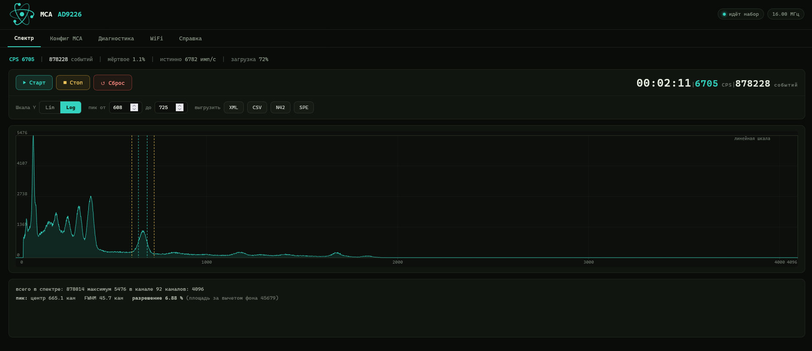
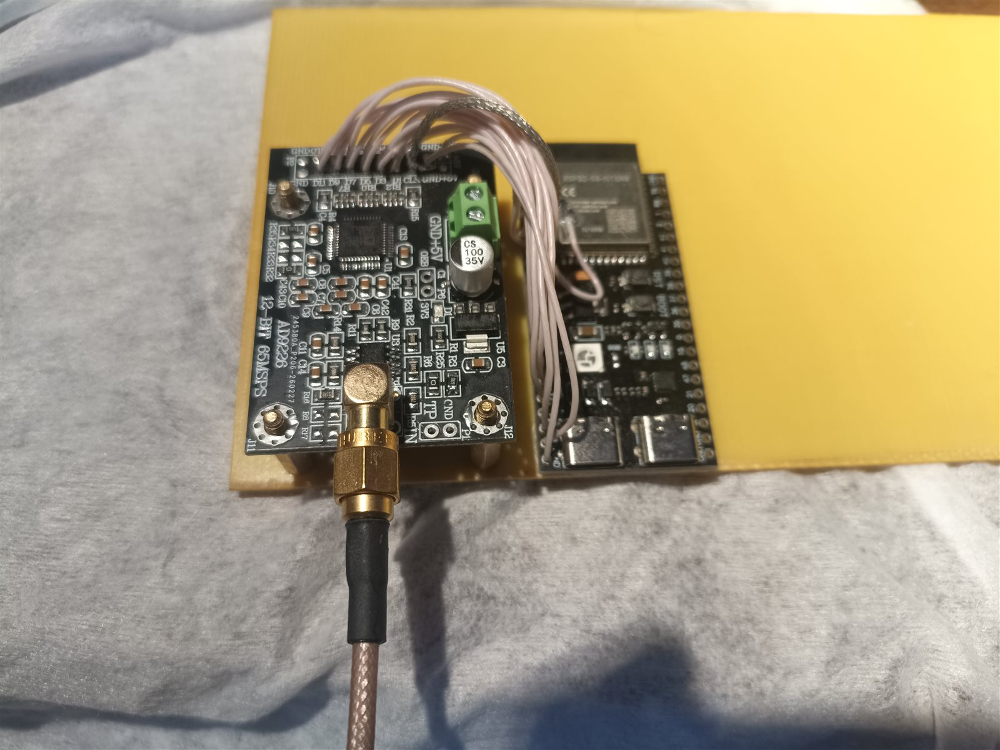
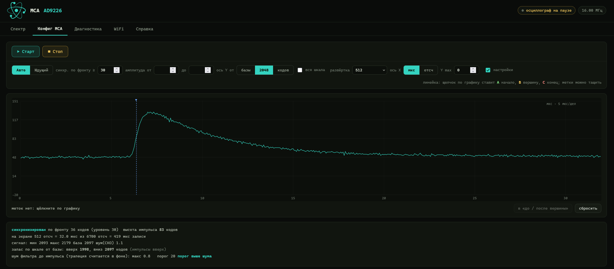
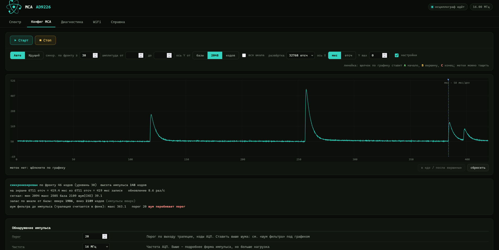
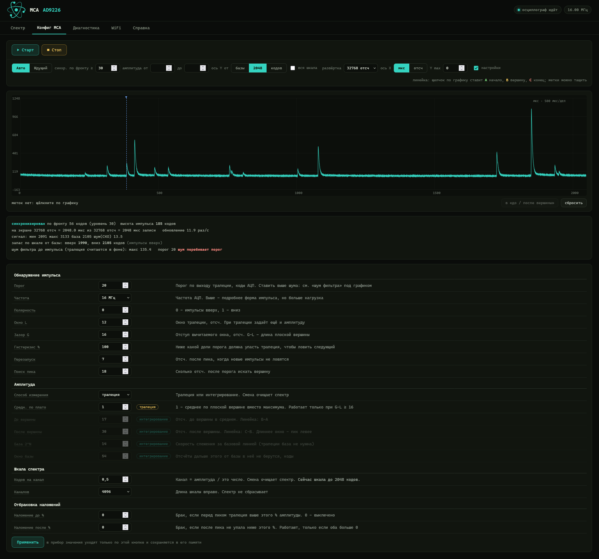
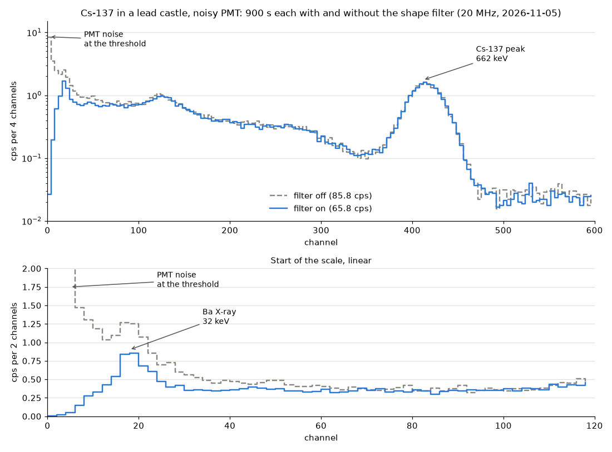
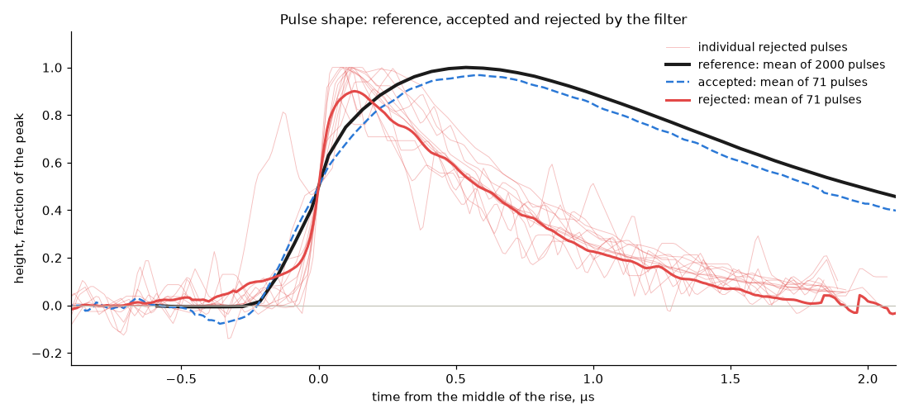

# MCA on ESP32-S3 + AD9226

[🇷🇺 Русский](README.md) · **🇬🇧 English** ·
[project site](https://qsxft446.github.io/esp32-Multi-Channel-Analyzer/en.html)

A multichannel pulse-height analyzer (gamma spectrometer) built on an
ESP32-S3-N16R8 and a 12-bit AD9226 ADC board. The ADC stream is captured by
hardware (LCD_CAM + GDMA), the second core does the signal processing, and
control and plots are served as a web page over the network.

**This copy targets the Waveshare ESP32-S3-ETH board** (ESP32-S3R8,
on-board W5500). The pinout in “Wiring” is for it. The device works
**over Ethernet only**, powered over PoE: there is no WiFi in this
firmware, and the ADC clock comes from the camera block (CAM_CLK, see
“ADC frequencies”).

ESP-IDF 5.4.4.

> The web interface is in English or Russian: the RU / EN switch is in the
> header, next to the ADC frequency. Firmware console messages are in
> Russian; where this document quotes one, a translation is given in brackets.



*Spectrum: 2 min 11 s of acquisition, 6705 cps, dead time 1.1 %, CLK 16 MHz,
4096 channels. Selected peak: centroid at channel 665, FWHM 45.7 channels,
resolution 6.88 %.*



*Prototype: AD9226 board and an ESP32-S3-N16R8 module board, data and CLK
wired with jumper wires.*

## Build and flash

```
idf.py set-target esp32s3
idf.py build
idf.py -p COM3 flash monitor
```

### Updating over the network

Firmware with the two-slot partition table (`partitions.csv`) accepts a new
version over the network. **The first time — over USB**: the previous table
had a single slot. Settings survive this — the `nvs`
partition stayed where it was.

After that, no cable is needed, by any of these:

- the “Settings” page, “Firmware” section: choose `build/esp32_mca.bin`,
  “Upload and restart”;
- `python tools/ota.py <ip>` — sends `build/esp32_mca.bin`, waits for the
  restart and checks that the new slot is running;
- `curl --data-binary @build/esp32_mca.bin http://<ip>/ota`.

Before writing, the device checks that the file is an ESP32-S3 image of this
same program (a bootloader, a partition table or unrelated files are
rejected), and after writing it checks the checksum of the whole image. The
write goes to the free slot; the running one is not touched.

**Rollback.** The new firmware counts as good after the first request to
`/stat` (an open page sends it) or `/ota`. If the device restarts before
that — crashes, hangs, never gets on the network — the bootloader brings
back the previous firmware by itself, and the console shows
`прошивка в слоте … не подтвердилась и была заменена прежней (откат)`
(firmware in slot … was not confirmed and was replaced by the previous one).

`GET /ota` returns the version, slot, state and the reason of the last reset
(`reset`: `poweron`, `usb`, `sw`, `panic`, `task_wdt`, `brownout` …) with the
uptime `up`: this shows over the network whether the device restarted by
itself.

**There is no password protection**: anyone who sees the device on the
network can flash it — just as they can change the other settings. Keep the
device on your own network.

**Network.** Connect the board with a cable to a network with DHCP (power
over PoE or from USB). The router assigns the address, and it is printed
in the console: `Ethernet подключён: http://<ip>/` (Ethernet connected).
There is no WiFi in this firmware, so without a DHCP address the device is
not reachable over the network — look at the address and errors in the
console over USB.

## Wiring

AD9226 board (connector P2) → Waveshare ESP32-S3-ETH. “Pin” is the header
number from the Waveshare pinout: 1–20 is the row starting at GPIO20,
21–40 the row starting at VBUS.

| ESP32-S3 | Pin | Signal | P2 |
|---|---|---|---|
| GPIO38 | 14 | DATA0 | 5 |
| GPIO39 | 12 | DATA1 | 8 |
| GPIO40 | 11 | DATA2 | 7 |
| GPIO41 | 10 | DATA3 | 10 |
| GPIO42 | 9 | DATA4 | 9 |
| GPIO47 | 5 | DATA5 | 12 |
| GPIO48 | 4 | DATA6 | 11 |
| GPIO1 | 25 | DATA7 | 14 |
| GPIO2 | 26 | DATA8 | 13 |
| GPIO15 | 29 | DATA9 | 16 |
| GPIO17 | 34 | DATA10 | 15 |
| GPIO21 | 35 | DATA11 | 18 |
| GPIO3 | 27 | DATA12/OTR | 17 |
| GPIO16 | 32 | **CLK (output)** | 6 |

+5 V to pins 1–2 (from the ESP32-S3-ETH: VBUS, pin 40, when powered from
USB), ground to 3/4/19/20, plus a separate short, thick ground wire
between the boards (board GND: pins 3, 8, 13, 18, 23, 28, 33, 38).

**The data lines run along both header rows:** this board has no run of
consecutive free pins. GPIO4–7 are taken by the microSD slot, 9–14 by the
W5500, 33–37 by the chip's Octal PSRAM, 19–20 by USB, 43–44 by UART0 (MCA
emulation), 0/45/46 are boot pins. OTR is on GPIO3: this boot pin selects
the JTAG source only when an eFuse is burned, otherwise its level at start
does not matter. LCD_CAM itself does not care about the line order, and the
data-line check in diagnostics assembles the word from the `MCA_DATA_PINS`
list.

**No CLK → PCLK jumper is needed.** The capture is clocked from the same
GPIO16 pin that outputs CLK: the pin's input is enabled as well and routed
through the GPIO matrix to the camera interface PCLK. This is the same
point the jumper used to come to — right at the pin, before the resistor.
To bring the jumper back, set a separate `PIN_CAM_PCLK_IN` in
`main/mca_config.h`, e.g. 18 (pin 31, next to GPIO16).

### How to route CLK

```
GPIO16 ──[ 47 Ω ]──── CLK wire ──────── CLK  (AD9226)
                      GND wire ──────── GND  (AD9226)
                      (twisted together)
```

- A single CLK wire goes to the ADC. Two long wires to one CLK point on the
  ADC board form a loop — a ready-made antenna.
- A 33–68 Ω series resistor **right at the GPIO16 pin**: PCLK is read from
  the pin, i.e. before the resistor. If PCLK were taken after the resistor
  (as with a jumper in the wrong place), the edge gets a step and the
  capture may trigger twice per clock.
- Twist the CLK wire with a ground wire; keep everything short and away
  from the module antenna (the end of the module without the metal shield).

This is about a clean clock at the ADC. On boards with WiFi the CLK
wiring also matters for the link — see “CLK interference with WiFi”.

## Ethernet (WIZnet W5500)

On the ESP32-S3-ETH the W5500 chip is soldered on the board, nothing needs
to be connected. It is **the only way to reach the device**: there is no WiFi
in this firmware (no access point, no client — the radio is never turned on),
power comes over PoE.

| W5500 | ESP32-S3 |
|---|---|
| SCLK | GPIO13 |
| MOSI | GPIO11 |
| MISO | GPIO12 |
| SCS (CS) | GPIO14 |
| INT | GPIO10 |
| RST | GPIO9 |

Pins follow the Waveshare schematic and are changed in `main/mca_config.h`
(`PIN_ETH_*`). The SPI bus runs at 20 MHz. The address comes from DHCP and is printed in the
console: `Ethernet подключён: http://<ip>/` (Ethernet connected), and shown
on the display, if one is connected.

On the “Settings” page (`/settings`, the old `/net` and `/wifi` addresses work too) the
“Network” (address settings) and “Firmware” (update over the network) cards sit side by side. If the W5500 did
not answer at start, the console shows `W5500 не отвечает - сети нет`
(W5500 does not respond - no network).

**Static address.** In the “Network” section of the “Settings” page —
“address from the router (DHCP)” or “static address” with address, mask,
gateway and DNS fields (an empty DNS equals the gateway). The device checks
the mask and that the gateway is in the same subnet. So that a mistake does
not lose the device:

- a new static address is applied at once but written to memory only after
  confirmation: the page opens on the new address by itself and confirms it.
  If there is no confirmation within 60 s (the address is not on your
  network, wrong gateway), the device returns to the previous settings; a
  restart within those 60 s brings them back too;
- the **BOOT** button on the board, held for 5 s while running (not at power
  on), switches back to DHCP;
- the current address is shown on the display and in the console.

## SSD1306 128x64 display (optional)

A small I2C OLED display shows:

- at the top — the device IP address (or `NO CABLE`, `WAITING FOR DHCP`,
  `NO ETHERNET`);
- on the next line — `RUN` (inverted, spectrum acquisition running) with
  the current CPS, `STOP` or `SCOPE` (oscilloscope open), and the ADC rate
  in MHz on the right;
- at the bottom — a CPS plot by acquisition seconds over the last 128 s,
  newest on the right; the scale runs from the minimum to the maximum on
  screen, both labelled. While acquisition is stopped, the plot does not
  move.

The layout also suits a two-colour display (the top 16 rows yellow, the
rest blue): both text lines lie entirely in the yellow band, the plot in the
blue one. On a single-colour display it looks the same.

| Display | ESP32-S3-ETH | Pin |
|---|---|---|
| SDA | GPIO18 | 31 |
| SCL | GPIO46 | 6 |
| VCC | 3V3 | 36 |
| GND | GND | 38 |

There are no other free pins on the header. GPIO46 is a boot pin, but at a
normal start its level does not matter; the pull-up on the display module
can only get in the way of entering the bootloader with the BOOT button —
then disconnect the display (it does not affect flashing over the USB cable
or over the network). GPIO45 does not fit: a pull-up at start would switch
the flash supply voltage.

The device finds address 0x3C or 0x3D by itself; the display can be
connected on the fly — it is looked for every 10 s. Pins, bus speed
(400 kHz) and 180° rotation (`MCA_OLED_FLIP`) are in `main/mca_config.h`.
The frame is drawn even without a display: `http://<ip>/oled.pbm` is what
is on the screen, as a picture. If the picture is shifted by a couple of
pixels with garbage at the edge, it is a 1.3" display with an SH1106
controller, not an SSD1306.

## MCA emulation on the serial port (shproto protocol)

The device can answer on a serial port as an MCA speaking the binary
**shproto** protocol — PC programs that work with such analyzers (for
example [BecqMoni](https://github.com/Am6er/BecqMoni)) see it as a regular
analyzer.

- **Port** — UART0: the “UART”/COM connector of the board (USB-UART
  bridge), not the native USB. Settings `8 N 1`.
- **Enabling** — “Oscilloscope” → settings → “MCA emulation on COM”: “off” or
  a baud rate
  `38400 | 115200 | 460800 | 600000 | 921600`. Takes effect immediately and
  is saved. The whole spectrum fits into one second only at 460800 and
  above.
- **The console is silent** while emulation is on: firmware messages are
  not sent to the port (nor to the native USB). Bootloader messages on reset
  still come out at 115200 — programs skip them. Flashing through this port
  works as usual.
- **Commands:** `-inf`, `-cal` (40 registers, read and write, stored in the
  device memory; by default there is no calibration and the serial number
  is derived from the MAC), `-sta [sec] [-r] [-s]`, `-sto`, `-sho`, `-stt`,
  `-rst`, `-mode 0`, `-spd`, `-frq` (nearest higher frequency from the
  table), `-reboot`. Every executed command is answered with the text
  `-ok`, and `-sta` at 38400 and 115200 with `Warning: silent mode forced
  due to low interface speed-ok`: these are exactly the answers BecqMoni
  waits for when starting an acquisition (without them it reports that it
  cannot read data from the port). Commands are parsed in the middle of a
  spectrum upload as well, so the answer comes in under a second at any
  baud rate. Factory tuning commands (`-ris`, `-fall`, `-U`, `-V`, `-nos`,
  `-pileup`…) are not executed and are answered with `-err not supported`:
  processing parameters are set on the device page.
- **During acquisition**, every second — a status packet (acquisition time,
  load, CPS, rejected pulses — pile-ups and off-scale events), then the
  whole spectrum: 8192 channels in packets of 64. `-sta` starts spectrum
  acquisition on the device itself, `-sto` stops it.
- **Dead time.** Programs compute it as
  `(spectrum sum + rejected) · (RISE + FALL + 1) / F`. After every detected
  pulse the device is blind for the peak search and the re-arm, so in the
  `-inf` answer `RISE` = “Peak search”, and `FALL` is chosen
  so that `RISE + FALL + 1` is the average number of dead-time samples per
  pulse (measured; while there are few pulses — “Re-arm”). The
  program’s live time then matches the device. In BecqMoni the dead time is
  read only by the dead-time button in the device settings: acquire a few
  seconds with a source first, then press it; press it again after
  changing the ADC frequency or processing parameters.
- **Channels — as set in the device “Channels” setting
  (2048/4096/8192).** The protocol and programs always hold 8192 channels:
  BecqMoni keeps the spectrum in an 8192-element array and itself sums
  `8192/N` adjacent channels to get the N channels from its settings.
  Therefore, when N is below 8192, the device stretches each of its
  channels over `8192/N` adjacent ones, splitting the count without
  remainder — and BecqMoni with **the same N in its settings** sums them
  back into exactly the device channels. Set the same number of channels in
  BecqMoni as on the device: on a mismatch the spectrum is stretched or
  compressed. Events above the scale (channels N to 8191) go to “rejected”,
  so that the “total pulses” and the dead time in the program stay correct.

PC check: `python tools/emu_check.py COM3 600000` — sends commands and
parses the answers according to the rules of the reference protocol (CRC,
escaping, `-inf`/`-cal` format, order of status and spectrum) and of
BecqMoni (answers to commands).

## Web interface

- **Language** — English or Russian, RU / EN buttons in the header next to
  the ADC frequency. The choice is remembered in the browser; without a
  choice the browser language is used (Russian for `ru`, otherwise English).
- **Spectrum** — acquisition, lin/log scale, analysis of the
  selected peak (centroid, FWHM, resolution), file export: XML
  (ResultDataFile, opens in BecqMoni), CSV (channel, count), N42
  (ANSI N42.42), SPE (SpectraLine).
- **Settings** — a separate page (link at the top): “Network” (address:
  DHCP or static), “Firmware” (version and update over the network) and
  “ADC settings” sections. The “Spectrum” and “Oscilloscope”
  tabs no longer carry settings or diagnostics — the oscilloscope fetches the
  windows, threshold and polarity it needs from the device by itself every
  5 s.
- **ADC settings.** The top of the table holds the sample rate, threshold,
  polarity and spectrum scale; the rest (trapezoid windows, measurement
  method, pile-up rejection, MCA emulation) is folded into “Advanced”, and
  the browser remembers whether it is open. The windows L, G, search and
  re-arm are in samples. They can be left alone: 5-minute acquisitions at
  16 MHz with L = 14, 20 and 28 samples gave the same 6.9–7.0 % resolution on
  the ~358 peak — on this board the trapezoid noise is much smaller than the
  peak width, and the resolution is set by the detector.
- **Pulse shape filter** — a card on the “Settings” page, enabled on
  demand and off by default: with a good PMT and its own power supply it is
  not needed. The shape measure is the effective pulse width: area / height
  in the “before / after peak” window (the same two numbers as for
  integration; with the filter on they are not dimmed in the table).
  Scintillations have almost the same width at any energy, PMT noise bursts
  are narrower. “Learn reference” — with a running acquisition (background
  is enough, a source is faster)
  the device takes 2000 pulses above three thresholds, the median of their
  width becomes the reference and is saved in the device memory. The filter
  rejects pulses whose width is farther from the reference than the
  “tolerance” (25 % by default). The reference is valid only for the window
  and ADC rate it was learned at: if they change, the filter passes
  everything and the card asks to learn the reference again. Below the
  buttons there are two plots. “Reference pulse” — the mean shape of the
  learned pulses (saved in the device memory together with the reference),
  with the last pulse within the tolerance (green) and the last one outside
  it (red) on top, each scaled to its height, with height and width; the
  light band is the measurement window. “Pulse width” — a histogram of
  area / height: green within the tolerance, red outside, the band is
  reference ± tolerance, the share outside the tolerance below. The card
  shows how many pulses were checked and rejected since “Reset” (`/stat`:
  `shchk`, `shrej`). At 20 MHz and ~5000 cps the filter works without chunk
  losses, but the core headroom is small (measurements — “Findings from
  debugging”, “Pulse shape filter”).
- **CPS monitor** — on the same tab, below the spectrum: current CPS, mean
  over the whole history with its error, last interval, a plot by averaging
  intervals with a moving average, an interval table and CSV export. The
  plot shows a time window — the last 30 s by default (“window” selector:
  30 s … 6 h) — and follows new data; wheel — zoom, drag — move into the
  past (the window then stays put), double click — back to the window and
  now. It used to show the whole history by default and got more and more
  compressed as the history grew. The history is a
  6-hour ring at one sample per second in the device PSRAM (~216 KB,
  `main/mca_hist.c`): it accumulates while the spectrum is acquired, even
  with the page closed; the page only fetches new samples. The CPS of an
  interval is the counts divided by the time acquisition actually ran
  (without lost chunks). “Clear history” does not touch the spectrum, and
  “Reset” does not touch the history. A gap in the plot appears only where
  there was no acquisition. The plot used to break sometimes in the middle
  of acquisition too: the time of a sample was computed from the moment of
  each page request, network delay shifted neighbouring samples, and a
  second stayed empty. Now the offset of the device clock against the
  browser is one for the whole history, and the device stamps a sample with
  the scheduled time of the one-second tick — exactly 1 s apart (it used to
  be the moment of writing, which wandered by a fraction of the main loop's
  100 ms step).
- **Device clock** — there is no real-time clock. The time comes from SNTP
  (`pool.ntp.org`) when there is internet access; otherwise any open page
  gives the device the browser time when the clock is unset or off by more
  than 2 s (and repeats hourly). The time and its source are shown in the
  monitor header; a spectrum export without a time from the page takes it
  from the device clock.
- **Oscilloscope** — edge triggering (auto
  and normal modes, time base 64–32768 samples, amplitude triggering —
  “amplitude from–to”: show only pulses whose height above
  the baseline is within the given range of ADC codes, X axis in µs or in
  samples from the trigger point), a ruler with A/B/C markers (start, peak,
  end of the pulse; the “set before / after peak” button writes them into
  the integration parameters right away).
- **Oscilloscope “codes/div” scale** — as on an ordinary oscilloscope: auto
  or 1, 2, 5 … 500 ADC codes per division, 8 divisions. The baseline sits on
  the first line from the bottom (from the top for downward pulses), the
  scale does not change from frame to frame, so the baseline noise of a few
  codes can be examined. A pulse above the screen is clipped, and how far it
  went is shown at the edge. The browser remembers the choice.
- **“Fix baseline”** — remembers the current baseline level, and from then
  on the oscilloscope draws from it rather than from the baseline of each
  frame: the baseline stays put on screen, and its slow drift shows under
  the plot as “drift”. Pressing again returns to per-frame measurement.
- **Start/Stop apply to the open tab:** on “Spectrum” — spectrum acquisition
  (together with “Reset”, the status line and acquisition
  time/CPS/events; the time runs only while the spectrum is being
  acquired), on “Oscilloscope” — only the oscilloscope: pause holds the last
  frame. Acquisition and the oscilloscope do not run together — the device
  has one mode. **The tabs only switch the view:** opening “Oscilloscope”
  does not start it. “Start” there, while acquisition is running, first
  warns that acquisition will stop (the accumulated spectrum is kept), and
  only after you agree stops acquisition and starts the oscilloscope; “Start”
  on “Spectrum” returns the device to acquisition. The device mode used to
  change as soon as the tab was opened: the oscilloscope started by itself,
  and acquisition silently paused. The header chip shows what the device is
  actually doing.
- **Diagnostics** — a separate page (`/diag`) with two cards:
  - **Device log** — firmware messages (ESP_LOG) since start: the device
    keeps the last 256 lines in PSRAM (`main/mca_log.c`), the page fetches
    new ones every second. Coloured by level: red (with the line
    highlighted) — errors, yellow — warnings, light — messages, grey —
    debug. The tag is coloured by subsystem: ADC, network, firmware,
    settings, display, emulation, system; numbers, addresses and values in
    the text are highlighted. The level and subsystem
    checkboxes (with line counts) hide what is not needed, “follow” scrolls
    to new lines, “Save” writes the log to a file.
    The log is visible even when the console is silent because of MCA
    emulation on COM: emulation turns off only printing to the UART, not the
    collection. Lines from before `app_main` (bootloader, core start) are not
    in the log — only in the console.
  - **ADC diagnostics** — sample stream and its real rate, per-bit
    statistics of the data lines, last-second profile (including processing
    busy time and CPU cycles per sample by stage — copy, difference,
    threshold and events — against the budget of 240 MHz / sample rate),
    chunk loss log with the device mode, data-line check.



*Oscilloscope paused, time base 512 samples (32 µs at 16 MHz): a single
pulse 83 codes high, baseline noise 1.1 codes RMS.*



*About 420 µs: pulses of different heights, on the right — a pile-up of two
consecutive pulses.*



*Time base 32768 samples (2 ms at 16 MHz) and the processing settings table:
parameters of the other measurement method are dimmed.*

## Pulse shape filter

**Why.** A noisy PMT or a noisy high-voltage supply adds short pulses of a
different shape to the scintillations: dark pulses at the threshold and rare
fast bursts of large height. By amplitude the trapezoid cannot tell them from
real events, and they land in the spectrum — as a mountain at the threshold
that hides low-energy lines, and as a flat background over the whole scale.
The shape filter looks not at the height but at the pulse width — area /
height in the “before / after peak” window. Scintillations have almost the
same width at any energy (set by the crystal and the amplifier), noise
bursts are 2–3 times narrower. Pulses whose width is farther from the
reference than the tolerance do not go into the spectrum.

**When it is not needed.** Factory detection units with a precision
low-noise high-voltage supply and a good PMT do not need the filter: they
have few noise pulses above the threshold, and the extra check only costs
core time. That is why it is off by default. Turn it on when the spectrum
has a mountain at the threshold that does not go away with the threshold and
the oscilloscope shows narrow single bursts.

**How to enable.** “Settings” page, “Pulse shape filter” card: start the
acquisition (background will do, a source is faster), “Learn reference”
(the device takes 2000 pulses above three thresholds and saves the mean
width and shape), tick “filter on”. The default tolerance is 25 %. The
reference is valid for the “before / after peak” window and the ADC rate it
was learned at; if they change, the filter passes everything and asks to
learn the reference again. The card shows the reference pulse with the last
accepted and rejected ones and a width histogram with the tolerance band.

**Check on the device** (2026-11-04): noisy PMT, weak Cs-137 in a lead
castle, 20 MHz, trapezoid L = 10, G = 51, threshold 16, tolerance 32 %; 333 s
each with and without the filter, the spectrum reset before each run.



| Channels | Without filter, cps | With filter, cps | Kept |
|---|---|---|---|
| below 12 (at the threshold) | 14.17 ± 0.21 | 0.70 | 5 % |
| 12–25 (Ba X-ray 32 keV) | 7.17 ± 0.15 | 4.03 | 56 % |
| 26–99 | 16.73 ± 0.22 | 12.33 | 74 % |
| 100–369 (Compton) | 29.07 ± 0.30 | 27.30 | 94 % |
| 370–454 (662 keV peak) | 18.30 ± 0.23 | 18.02 | 98.5 % |
| above the peak | 4.27 ± 0.11 | 4.01 | 94 % |

Without the filter the barium X-ray (32 keV) drowned in the noise at the
threshold; with the filter it is a separate peak (peak / valley 2.04 → 2.39).
The 662 keV peak is almost untouched: by a Gaussian fit 16.92 → 16.56 cps
(−2 %), resolution 9.57 → 9.43 %. In total 25 % of pulses are rejected. No
chunk losses, core load 84 % in both runs.



The reference is the mean of 2000 pulses aligned at the middle of the rise
(learned at 16 MHz; the examples at 20 MHz, the axis is in microseconds): a
round top ~0.5 µs after the middle of the rise, decay to half another ~1.4 µs
later. The rejected ones are the mean of 71 pulses, one per page request:
rise ~0.4 µs, decay to half in ~0.45 µs; among them there are small ones at
the threshold (20–30 codes) and tall ones, up to the top of the ADC. Where the
tall fast pulses come from was not checked (an assumption — muons in the PMT
glass or discharges in it).

**Cost.** The measure is computed once per event. With integration the filter
takes the peak and the window sum from the integration itself. At 20 MHz and
~5000 cps there are no losses with the filter (5 min), but the core headroom
is small — about 1.1 cycles per sample out of 12; with a noticeably higher
count rate watch chunk losses on the “Diagnostics” page, if there are losses
use 16 MHz. Details and measurements — “Findings from debugging”, “Pulse
shape filter”.

## Architecture

**Capture.** LCD_CAM in camera mode + GDMA, a ring of 16 buffers of 2046
samples. The size is almost the limit: the length field of a GDMA
descriptor is 12 bits (up to 4095 bytes). With 8192 bytes the mask gave
zero, the controller got a zero-size buffer and silently delivered no
chunks at all. The queue depth equals the number of buffers: an index in a
deeper queue would point to an already overwritten buffer.

**Cores.** Core 1 — the processing task (`dsp`). Core 0 — network (W5500,
TCP/IP), web server and the capture interrupt.

**Processing.** Recursive trapezoidal filter. The window difference is
computed with ESP32-S3 vector instructions (PIE), 8 samples at a time; at
start it is self-checked against the plain code, and if the check fails the
plain code is used. Events are detected on the trapezoid output; the
amplitude is taken from the trapezoid top or by integrating the samples
around the peak minus the baseline. Pile-up rejection, dead time,
hysteresis. The histogram has 8192 channels in PSRAM; 2048/4096/8192 are
shown; “Codes per channel” sets the scale.

**Only what is open is processed:** the spectrum is not computed in
oscilloscope mode.

### ADC frequencies

In this copy CLK comes from the camera block (CAM_CLK, `MCA_CLK_GEN_CAM 1`)
with integer dividers from 160 and 240 MHz: 1, 2, 4, 5, 6.67, 8, 8.89, 10,
11.43, 12, 13.33, 15, 16, 17.14 and 20 MHz. LEDC (`MCA_CLK_GEN_CAM 0`, only
80/K) corrupts the data on this board at 16 MHz — see “A CLK generator
from the camera block”.

Measured on this board (2026-10-28, ~3500 cps, 5 s per rate): in spectrum
mode the processing task takes ~72 % of core 1 at 16 MHz and ~89 % at
20 MHz, no chunk losses; the load grows in proportion to the rate and with
the count rate. In the oscilloscope at 20 MHz the queue reaches 16/16 and
losses happen (on the chunks where the window is captured). Hot-loop
estimate (`tools/hotloop.py`): ~5.4 cycles per sample while waiting for an
event (1.75 — vector difference, 3.6 — search).

The page gets the frequency list from the firmware (`/cfg`, field `fl`),
its own for each CLK generator. The frequency is stored in the device
memory in hertz.

## Findings from debugging

### CLK interference with WiFi

*Does not apply to this copy: it has no WiFi. The section comes from the
main project, for boards with WiFi.*

**Symptom.** At 16 MHz the oscilloscope refreshed in waves, `/scope`
responses took up to 1–3 s, and ping to the device jumped up to 350 ms. The
longer the time base, the worse.

**What the experiments showed** (console profile, see below):

| Experiment | Result |
|---|---|
| 16 MHz, capture running | core 1 is 3 % busy, no losses — yet the link breaks |
| 16 MHz, **capture stopped**, core 0 is 2–4 % busy | the link still breaks |
| only CLK changed to 13.33 MHz | within a second `/scope` 10 times/s at 10–16 ms |
| only the router channel 10 → 6 | much better: 9–10 times/s at 45–98 ms |
| 16 MHz, router channel 1 | “everything is bad” |
| 16 MHz, router channel 8 | fine |

So the CPU and the software are not to blame: the CLK signal interferes. A
square wave contains all multiples of its frequency; 154 × 16 MHz =
2464 MHz — inside channel 10 (2457 ± 8.75 MHz). The CLK wires are an
antenna a few centimeters from the module antenna, and the WiFi receiver is
very sensitive: some packets get lost and TCP waits for retransmissions. A
longer time base means more packets per response and a higher chance of
losing at least one.

**What it depends on.** What matters is not the ADC frequency by itself but
**the pair “ADC frequency + router channel”**: whether a strong harmonic
falls into the channel band (centre 2407 + 5·N MHz, ±8.75 MHz). The
strength of harmonic number n of a square wave with duty cycle D is
proportional to |sin(π·n·D)|/n:

- 16 MHz (80/5) has a 40/60 duty cycle, and the harmonics alternate in
  strength: 2416 MHz (channel 1) and 2464 MHz (channel 10) are strong,
  2432 and 2448 MHz (channels 4–9) are about 40 % weaker, 2400 and
  2480 MHz are zero. Exactly what the experiment shows: channels 1 and 10
  are bad, 6 and 8 are fine;
- 13.33 MHz (80/6) is a 50 % square wave, even harmonics almost vanish.
  Only even ones fall into channels 4, 9 and 10 — those are clean. On the
  other channels a strong odd harmonic is in the band, and 13.33 MHz is
  worse there than 16 MHz.

Other ESP32 projects see the same: a 5/10/20 MHz clock on a pin degrades
WiFi, 8 MHz does not ([arduino-esp32 #5834](https://github.com/espressif/arduino-esp32/issues/5834));
a 20 MHz camera clock — 50 lost pings out of 60, at 2 MHz not a single TCP
retransmission ([AI-on-the-edge #3558](https://github.com/jomjol/AI-on-the-edge-device/issues/3558));
for some 20 MHz fixes it, for others 8 MHz does ([ESP32-HUB75 #258](https://github.com/mrcodetastic/ESP32-HUB75-MatrixPanel-DMA/discussions/258)).
The latter is not a contradiction: everyone has different router channels.

**Which pair to choose.** Calculated with the formula above and calibrated
against measurements at 16 MHz: ✓ — clean, ~ — usable (like 16 MHz on
channels 6 and 8), ✗ — the link breaks (like 16 MHz on channels 1 and 10).

| ADC, MHz | 1 | 2 | 3 | 4 | 5 | 6 | 7 | 8 | 9 | 10 | 11 | 12 | 13 |
|---|---|---|---|---|---|---|---|---|---|---|---|---|---|
| 1, 2 | ✓ | ✓ | ✓ | ✓ | ✓ | ✓ | ✓ | ✓ | ✓ | ✓ | ✓ | ✓ | ✓ |
| 4 – 10 | ~ | ~ | ~ | ~ | ~ | ~ | ~ | ~ | ~ | ~ | ~ | ~ | ~ |
| 11.43 | ✗ | ✗ | ~ | ~ | ~ | ~ | ~ | ~ | ~ | ~ | ✗ | ✗ | ✗ |
| 13.33 | ✗ | ✗ | ✗ | ✓ | ✗ | ✗ | ✗ | ✗ | ✓ | ✓ | ✗ | ✗ | ✗ |
| 16 | ✗ | ✗ | ✗ | ~ | ~ | ~ | ~ | ~ | ~ | ✗ | ✗ | ✗ | ✗ |
| 20 (oscilloscope) | ✗ | ✗ | ✗ | ✗ | ✓ | ✓ | ✓ | ✓ | ✗ | ✗ | ✗ | ✗ | ✓ |

The calculation assumes ideal edges; in reality high harmonics are even
weaker, so low frequencies are safer than the table shows. Verified on the
device: 16 MHz on channels 1, 6, 8, 10 and 13.33 MHz on channel 10.

### Change the WiFi channel on your router

*Does not apply to this copy: it has no WiFi. The section comes from the
main project, for boards with WiFi.*

This is the fastest and free fix: on the device at 16 MHz, the link that did
not work at all on channel 1 became fine on channel 8.

1. Find out the current router channel: on connecting, the device prints
   `STA подключена: http://<ip>/ канал N (МГц)` to the console.
2. Open the router settings in a browser — that is the gateway address
   (usually `192.168.0.1` or `192.168.1.1`; the device prints it in the
   console as `gw`).
3. Wireless section, 2.4 GHz band → Channel: instead of “Auto” set a
   **fixed** channel from the table for your ADC frequency. For example,
   channel 8 for 16 MHz (4–9 are fine), channel 9 or 10 (or 4) for
   13.33 MHz.
4. Set the channel width to **20 MHz** rather than 40 or “auto”: the wider
   the band, the more harmonics fall into it.
5. Save. The device reconnects by itself, and the console shows the new
   channel. The `MCA-Setup` access point moves to the same channel
   automatically.

Why not “Auto”: the router may switch at any moment to a channel where a
CLK harmonic kills the link, and the device “suddenly” stops responding. If
several channels fit, pick the one with fewer neighbouring networks.
Changing the channel affects all devices on that network — they reconnect
by themselves.

### What else helps (from strongest to weakest)

*Does not apply to this copy: it has no WiFi. The section comes from the
main project, for boards with WiFi.*

1. CLK wiring — see “How to route CLK”: a short wire twisted with ground,
   a series resistor at GPIO16. Slowing the edges suppresses exactly the
   high harmonics the most.
2. An ESP32-S3 module with an external antenna connector, the antenna
   10–20 cm away from the ADC board.
3. A shield made of **copper-clad PCB laminate** connected to ground. Cover
   the side of the ESP32 board where the data and CLK wires reach the
   pins — this separates the wire bundle from the module antenna.
   Important:
   - **do not cover the antenna.** It is the end of the module without the
     metal shield. Keep copper at least ~15 mm away from it; the antenna
     end of the module must stick out past the edge of the shield. Metal
     near the antenna detunes it, and the link gets worse, not better;
   - **ground the copper:** connect it to the ESP32 board GND with a short,
     wide conductor, preferably in two or three places. An ungrounded plate
     re-radiates the interference at 2.4 GHz;
   - copper side facing out, or covered with Kapton tape, so the pins are
     not shorted;
   - even better — lay the wires directly on the grounded copper: a wire
     lying on a ground plane has a small current loop and radiates almost
     nothing.

   In the prototype photo above the wire bundle arcs over the module next
   to the antenna — a shield and routing the wires away from the antenna
   should noticeably reduce the interference.
4. A “frequency + channel” pair from the table — works around the
   interference but does not remove it.

WiFi power saving is already disabled on the device (`WIFI_PS_NONE`) —
this is also recommended for such interference. Spread-spectrum clocking
(the clock frequency slowly wanders by a fraction of a percent) is a
standard anti-EMI technique, but LEDC cannot do it; it is only possible
with an external clock generator.

It is not known exactly how the interference reaches the receiver — over
the air or through power and ground. The measures are the same.

### A CLK generator from the camera block — the main one in this copy

`adc_clk.c` contains a second generator: the CAM_CLK output of the LCD_CAM
block, integer dividers from 160 and 240 MHz (up to 20 MHz, including 12,
15, 17.14). It is enabled with `MCA_CLK_GEN_CAM 1` in `mca_config.h`. The
calculation promised that at 17.14 MHz (240/14) channel 6 would be clean —
assuming a 50 % square wave. In practice, with capture **stopped**, ping
went 0.3–1.25 s with losses and the interface stopped opening: much worse
than 16 MHz from LEDC. So CAM_CLK is not a clean square wave (the
documentation does not promise the duty cycle of this output). We went back
to LEDC. That was on the previous board with WiFi; this copy has no WiFi, and
CAM_CLK is the main generator (`MCA_CLK_GEN_CAM 1`): see the measurement
below.

**On the Waveshare ESP32-S3-ETH, 16 MHz from LEDC corrupts the data.**
Measured over the network, raw oscilloscope frames with the same wiring and
signal:

| Generator, frequency | Runs | Jumps > 200 codes | Samples 0/4095 | OTR |
|---|---|---|---|---|
| LEDC, 1–13.33 and 20 MHz | 11 | 0–0.02 % | 0 | quiet |
| LEDC, 16 MHz (80/5, duty 40/60) | 7 | 7–47 % | 2–16 % | fires |
| CAM_CLK, 16 MHz (160/10) | 5 | 0 % | 0 | quiet |
| CAM_CLK, 8–20 MHz | 5 | 0 % | 0 | quiet |

OTR is driven by the AD9226 itself and is read from the GPIO, bypassing the
camera interface, so it is the conversion in the ADC that breaks, not the
capture. The odd LEDC dividers 80/7 and 80/9 (also not 50 %) work cleanly —
what exactly is wrong with the 16 MHz clock from LEDC is not known yet: it
needs an oscilloscope on the CLK pin at the AD9226.

The generator switch takes into account that resetting LCD_CAM also stops
this clock, so the module clock source and divider are set only by
`adc_clk` (`adc_clk_cam_apply`), and `adc_cap` calls it after the reset.

### TCP send buffer

By default `CONFIG_LWIP_TCP_SND_BUF_DEFAULT` = 5760 bytes (4 segments). A
16–32 KB `/scope` response took 6 “burst — acknowledgement” round trips,
and a lost tail cost a timer retransmission (1.5 s). It is set to 16384 —
the response goes in one or two round trips. This is a limit, not
pre-allocated memory.

### Oscilloscope

- **Window sized to the time base: up to 8192 in internal RAM, longer in
  PSRAM.** The device collects exactly what the page requests: the time
  base plus the trapezoid margin, with one fifth of the screen before the
  trigger (the prehistory used to be always 6144 samples). At 20 MHz with
  the windows in PSRAM chunks were lost — only in the oscilloscope and
  only during `/scope` requests: writing one capture buffer into the
  window took up to 0.9 ms against a 0.1 ms budget. The PSRAM data cache
  is 32 KB, the window up to 64 KB, and the web was reading the snapshot
  from there at the same time. Now two windows of up to 8400 samples
  (2 × 17 KB) live in internal RAM and two full ones in PSRAM for the
  16384 and 32768 time bases; with those, losses are possible at 20 MHz.
  (The window was once moved to internal RAM because of page freezes —
  that time the cause turned out to be CLK harmonics in WiFi.)
- **The snapshot is sent to the network straight from its buffer**,
  without a copy: while the response is being sent no new frames are
  published, and the next window is collected in another buffer.
- **Pre-trigger history without copying.** Up to 6 KB used to be copied
  per chunk, with a budget of 128 µs per chunk at 16 MHz. Now pointers to
  the four previous capture buffers are kept (history up to 6144 samples),
  and the copy is made once on trigger. The edge is searched only when the
  history is complete — otherwise the first frames after capture start
  (it restarts on tab switch and after pause) would jump across the screen.
  Every capture start is marked as a stream gap: the spectrum filter and
  the oscilloscope history are reset. If the queue is almost full, the
  trigger is skipped: otherwise the history would be taken from a buffer
  that DMA is already overwriting.
- **Edge search with step 4 + exact refinement.** Four times cheaper than a
  full scan, same trigger point. A model against a full scan on 4000
  random chunks: 0 differences on real edges; differences only where the
  full scan triggered on a noise spike shorter than 4 samples.
- **Lock-free snapshot.** The web copies the snapshot under a “reading”
  flag; publishing does not swap buffers meanwhile and just skips the
  frame. The web used to hold a mutex during the copy, and the processing
  task took it on every chunk — that caused losses.
- **Amplitude triggering.** Triggering is still on the edge, but after it
  the device measures the pulse height: the maximum over 256 samples after
  the edge minus the mean of 64 samples before it (ADC codes, taking
  polarity into account). Outside the “from–to” range the frame is dropped
  as soon as those 256 samples are in, without waiting for the end of the
  window, and the device waits for the next edge. The height of the shown
  pulse and the number of dropped ones since the previous frame are printed
  under the plot.
- **Frames go over WebSocket (`/ws`), losslessly compressed.** The page
  sends its settings there (time base, level, amplitude, pause), and the
  device pushes a frame only when the snapshot is new and the previous
  frame has gone out, at most 20 times per second. The page used to poll
  `/scope` and in normal mode got the same frame over and over; over
  Ethernet (W5500) that was 3 Mbit/s at the 16384 time base and 4 Mbit/s
  at 32768 — close to the module's SPI limit. Samples are sent as 4-bit
  differences (`main/scope_codec.c`): a difference of −7…7 is one nibble,
  otherwise an escape and the full sample. On the signal model a frame is
  3.4–4 times smaller: 16384 — 33 → 8 KB, 32768 — 66 → 20 KB. The message
  is cut into 4 KB pieces, so compression runs on the fly without a large
  buffer. At start the device self-tests the codec; if that fails, frames
  go uncompressed (the page understands both). Under the plot you can see
  “stream … kbit/s” and which way it goes.
- **Frames go to one window — the one where the oscilloscope is running.**
  The page sends its settings every 2 s, also when its oscilloscope is
  paused or the spectrum is open. Such a message from a second window used
  to take the stream over and stop it: in the window being watched the
  picture froze for up to 2 s. Now a paused window does not touch the
  stream, and a new connection does not interrupt a running one. If the
  oscilloscope is running in two windows at once, frames switch between
  them every 2 s — watch in one.
- **The page also draws at most 20 times per second**, at any time base.
  Large frames arrive over TCP in bursts; when each was drawn at once, the
  browser could not keep up with 32768 points, frames piled up, and the
  refresh rate first raced and then dropped. Now a frame that arrives
  early waits, and the next one replaces it — the freshest is drawn.
  “Refresh … /s” is the number of frames drawn per second.
- If the WebSocket does not open, the page polls `/scope` as before: the
  response is binary (7 × int32 + uint16 samples), the next request right
  after drawing, at most every 50 ms. The device prepares snapshots at
  most every 25 ms.

### Pulse shape filter

- **What PMT noise looks like** (noisy PMT, background without a source,
  2026-11-03, 20 MHz, 360
  oscilloscope frames of 32768 samples, ~0.6 s). Baseline: σ ≈ 1.6 codes,
  swing over 26 µs — 10 codes, 0.4 ms — 15, 1.6 ms — 18 (the baseline also
  wanders slowly by a few codes). Single spikes of 1–2 samples, ~3300 per
  second, 8–9 codes high: the trapezoid with L = 12 damps them L times, they
  do not reach the spectrum. Above the threshold there are two kinds of
  pulses: scintillations — FWHM ~40 samples, rise ~10, area / height 50 ± 4
  at any height from 40 to 4000 codes; and narrow ones — width ~10, rise ~3,
  area / height 15–33, nearly all 15–60 codes high: they make the pile at
  the start of the spectrum. That the narrow ones are PMT noise or pickup and
  not events is a conclusion from their shape; their source was not checked.
- **Why the measure is area / height.** It is computed once per event, not
  per sample. The measure's baseline is the eight samples right before the
  window, not the common baseline: so the tail of the previous pulse does
  not change the width.
- **What it costs and how it fit into 20 MHz.** Temporary cycle counters
  (2026-11-04, 20 MHz): ~650 cycles per event — peak search 323 (48
  samples), window sum 259 (58 samples), the rest ~64. With a source (~5000
  cps) at 20 MHz the filter lost ~130 chunks per second. What did not help:
  32-bit division instead of 64-bit (same cost); a two-pass peak search and
  summing two samples per read (slower: 460 and 280); vector instructions for
  the maximum and the sum (no better than plain code in cycles per sample,
  and the build with them by itself added +0.07 cycles and losses without the
  filter) — all reverted. What helped:
  - with integration, the peak and the sum of the “before / after peak”
    window are already found by `amp_integrate` — the filter takes them
    instead of searching again;
  - both `amp_integrate` and the filter look for the signal peak no earlier
    than “threshold crossed minus L” (the threshold is crossed no later than
    L samples after the start of the rise). Integration used to search
    L + G + 5 samples back from the trapezoid peak (~100 samples). On the model
    the spectrum does not change.

  Measurements at 20 MHz with a source, filter off / on for 20 s (device
  settings: integration, L = 21, G = 78, tolerance 10 %):

  | Build | Filter | Chunks lost | Cycles per sample (of 12) |
  |---|---|---|---|
  | before | off | 0 | 10.91 |
  | before | on | ~2700 per 21 s | 11.08–11.13 |
  | peak and sum from integration | on | 113–155 per 21 s | 10.95–10.97 |
  | + search from the threshold crossing | off | 0 | 10.84 |
  | + search from the threshold crossing | on | 0 | 10.88 |
  | same, trapezoid | off / on | 0 / 0 | 10.64 / 10.82 |

  Five minutes at 20 MHz with the filter (~5000 cps, 1.58 million checked
  pulses): 0 losses, load at most 90.8 %. The headroom is about 1.1 cycles
  per sample: with a noticeably higher count rate 20 MHz may not be enough
  even without the filter. At 16 MHz (budget 15 cycles) with the filter it is
  11.24 cycles, no losses.
- **What it rejects.** Everything below is on background, ~330 cps. The
  reference on this PMT, learned on background, is 34.1 samples (window
  13 + 36 + 1, 10–90 % spread 28.7–36.1), tolerance 25 %: 25.7 % of the
  checked pulses were rejected (3 min, 59 870 pulses). From the device map
  (later replaced by the reference pulse and the width histogram):
  channels 1–15 — 89 %, 15–40 — 11–14 %, 40–100 — 6–9 %, 100–200 — 3.5 %,
  above 200 — under 1 %, and all rejected ones are narrower than the band,
  none wider. The model (`dspmodel.py`) on the captured frames with the same
  reference: reference from its own events 33.6, rejected 18.3 % (32 of 175 —
  few events), also almost all below channel 25. With a source (~5000 cps)
  13–14 % are outside the tolerance; the reference at 20 MHz is 34.0 samples,
  at 16 MHz 31.1 (the same pulse, fewer samples on it).
- **A chunk loss that did not repeat.** In the first run on the device, 31
  chunks were lost ~1 s before the reference learning finished: one chunk
  took 14.4 ms to process against a budget of ~0.1 ms (loss log,
  `/diag/data`). A second learning run, each action one at a time (saving
  settings, “Reset”, clearing the map, enabling the filter) and two 3-minute
  acquisitions (filter with the map and without) gave no losses. The cause
  was not found. (This is on background; the losses with a source at 20 MHz
  are a different matter, see “What it costs”.)
- **A kink at the reference top.** At first the reference was accumulated
  with pulses aligned at their highest sample. Real pulses have a wide,
  almost flat top (~10 samples within 0.97–1.00), and noise throws the
  position of the maximum around: for 59 pulses from 0.7 to 13.8 samples after
  the middle of the rise. The rise on the left is steep, the decay on the
  right is gentle — the mean got a step left of the top (0.84 → 0.93 → 1.00)
  that the pulses do not have. Now pulses are aligned at the first rise
  sample above half the height: the top is smooth (0.961 → 0.983 → 0.995 →
  1.000 → 0.997). The model does not reproduce the kink (all its pulses have
  the same top), so it was checked on the device. This is display only: it
  does not affect the filter decision.
- **The height is the maximum, not a smoothed top.** The maximum of several
  nearly equal samples is biased up by noise (~2 codes): for a 300-code
  pulse this is under 1 %, for a 20–30-code pulse (barium X-ray) 7–10 %, and
  small real pulses come out narrower. Smoothing the top would fix this, but
  a check on 71 accepted and 71 rejected pulses showed worse separation: noise
  bursts have a sharp top, and smoothing widens them more.

  | Height from | Small accepted (<60 codes) | Rejected: 95 % / max | Gap |
  |---|---|---|---|
  | 1 sample (kept) | 23.0–35.2 | 19.7 / 22.4 | 1.35 |
  | 3 samples | 25.2–35.6 | 22.2 / 26.9 | 1.24 |
  | 5 samples | 26.4–36.3 | 23.1 / 31.6 | 1.21 |

  Gap — 5 % of accepted widths to 95 % of rejected. The tolerance (25–40 %)
  covers the narrower width of small pulses.

### Other

- Pinning the TCP/IP task to core 0 made things worse: the web waited
  longer for its core. Left unpinned, but the processing task now has
  priority 19, above TCP/IP (18): when TCP/IP moved to core 1 it
  preempted the processing (which had 10), and at 20 MHz the capture
  queue holds only 1.6 ms.
- Processing statistics and parameters are under a spinlock, not a
  mutex. “Apply” and “Reset” held the mutex while clearing the histogram
  in PSRAM and printing to the console, and the processing task waited
  milliseconds — guaranteed losses. Now the processing task itself clears
  the spectrum and restarts the filter, the histogram in pieces of 1024
  channels per chunk; during these ~0.8 ms of the stream the spectrum is
  not acquired and the acquisition time does not run. “Reset” now also
  zeroes the above-scale event counter, which used to accumulate.
- The spectrum is read without locking; events are written to the histogram
  without a mutex, and the accumulated counts are flushed once per chunk.
- **GPIO matrix constant levels come from ESP-IDF, not as numbers.** On
  the ESP32-S3 the constant one is `0x38` and the constant zero is `0x3C`
  (`soc/esp32s3/include/soc/gpio_pins.h`). The firmware used to have
  `0x30` — the zero of the classic ESP32, but on the S3 it is the
  ordinary pin GPIO48. The “constant zero” on the frame sync input and
  the spare data lines actually read GPIO48. On the author's board it
  idles low, so everything worked by chance; on boards with an LED on
  GPIO48 (ESP32-S3 Super Mini, Arduino Nano ESP32) the camera never saw
  a frame start, and not a single chunk arrived although the clock was
  running. Found when the project was being repeated. The values now come
  from ESP-IDF, and the build checks that the constant does not match a
  real pin number. Unused CAM data lines are tied to zero so they do not
  pick up noise; if the zero is not a zero, diagnostics shows it (the
  “high bits 12–15” line).
- Rates “per second” (sample rate, CPS, chunks) are computed over the
  actually elapsed time: the one-second tick comes from the lowest-priority
  main loop, and under core 0 load (for example, spectrum upload over COM)
  it stretched to 1.1–1.2 s, overstating the rate by 10–20 %.

## Console diagnostics

By default the profile is not printed to the console — only the line
`потеряно чанков: N, при последней потере шёл /…` (chunks lost: N, the
request in progress at the last loss was /…), and only in the second when
losses happened. The “Diagnostics” page always shows the
profile. To enable printing: `#define MCA_PROF_LOG 1` in
`main/mca_config.h`. Then every second:

```
prof: q=4/16 work=0.90 wait=0.23 busy 75% lost=0 | sp 1x23 sc 10x14 st 1x1 | heap 125k/87k load 71% cps 2242
prof: cpu0 5% cpu1 86% | dsp(1) 85.4% httpd(0) 2.2% main(0) 0.9% tiT(*) 0.5%
```

| Field | Meaning |
|---|---|
| `q` | peak chunk queue depth; 16/16 — losses will follow |
| `work` / `wait` | longest chunk processing / wait for a chunk, ms |
| `busy` | share of time the processing task is busy, in any mode |
| `lost` | chunks lost per second |
| `sp`, `sc`, `st` | `/spectrum`, `/scope`, `/stat` requests per second × the longest, ms |
| `heap` | free internal memory / its all-time minimum |
| `load` | load inside spectrum processing |
| `cpu0`, `cpu1` | core load from FreeRTOS accounting (interrupt time counts toward the interrupted task) |
| `task(core)` | busiest tasks; `*` — not pinned to a core |

For each loss there is a line `ПОТЕРЯ +n q=… шёл /ep Xms work=…` (LOSS):
which request was being served at that moment and for how long.

## Other ESP32-S3 boards

The firmware is built for the ESP32-S3-N16R8 (DevKitC) but also starts
on other ESP32-S3 boards:

- **Flash.** The firmware header says 4 MB: if it says more than the
  board has, ESP-IDF stops the start (`ESP_ERR_FLASH_SIZE_NOT_MATCH`).
  On 16 MB there is only a warning at start.
- **PSRAM.** Without it, or with another type (Quad, as on N4R2), the
  device does not crash but works without it: no 6-hour CPS history and
  no 16384 and 32768 oscilloscope time bases. To get everything, set your
  PSRAM type in `idf.py menuconfig` (Component config → ESP PSRAM).
- **Pins.** This copy is wired for the Waveshare ESP32-S3-ETH (see
  “Wiring”). For another board, change the pins in `main/mca_config.h`.
  Avoid GPIO0, 45, 46 (boot), 19–20 (USB), 26–37 (flash and PSRAM on
  modules with Octal PSRAM).

## Bring-up on new hardware

1. Frequency 1–2 MHz, “Oscilloscope” tab, “Auto” mode,
   Start. Feed something known to the input. Expect a sensible trace. If
   the data is all zeros — check the R32–R35
   jumpers on the AD9226 board. If there are no chunks while PCLK is alive,
   the camera interface control-signal mode does not fit: the `s_mode`
   fields in `main/adc_cap.c`. On this board the working mode is all
   polarities non-inverted, frame sync tied to constant zero; it was found
   by trying all 48 variants (variant 16), after which the search was
   removed from the firmware. On the “Diagnostics” page, the “high
   bits 12–15” line must be 0, and “Check data lines” must show D0–D11
   toggling.
2. Signal from the PMT: a flat baseline between pulses, headroom on the
   ADC scale.
3. Raise the frequency step by step, checking the oscilloscope and `lost`
   in the console (or on the “Diagnostics” page) at each step. Data
   jumping to 0 and 4095 and OTR firing at one rate means the clock reaches
   the ADC in bad shape (as with LEDC at 16 MHz, see “A CLK generator from
   the camera block”).
4. Spectrum: threshold above the trapezoid noise (the “filter
   noise” line under the oscilloscope), L and G from the pulse shape,
   “Codes per channel” so the peaks fit the scale.

## Tools (`tools/`)

- `test_dsp.py` — 12 levels of processing checks on a model, including the
  vector version against the plain one, the oscilloscope frame compression
  against the page decoder, the splitting of the CPS history into intervals
  and the timing of its samples under network delay (the page functions run
  in node), the shape filter on a signal with scintillations and noise
  bursts. `python tools/test_dsp.py`.
- `dspmodel.py`, `scopemodel.py`, `scopecodec.py` — models of the
  processing, the oscilloscope and its frame compression.
- `hotloop.py` — hot-loop cycle estimate from the disassembly.
- `mkpage.py` — builds `build/page_test.html` with the device page and stub
  responses; open with `python -m http.server 8777 --directory build`.
- `emu_check.py` — checks the MCA emulation on the serial port from a PC
  (`python tools/emu_check.py COM3 600000`; `--selftest` checks the codec
  only).
- `check_i18n.py` — checks that every label of the device pages has an
  English pair (`python tools/check_i18n.py`).
- `ota.py` — flashing over the network (`python tools/ota.py <ip>`, see
  “Updating over the network”).
