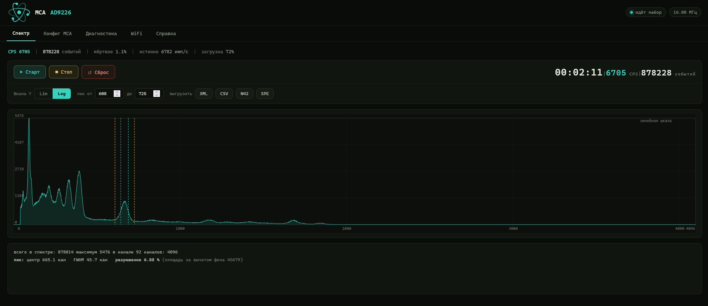
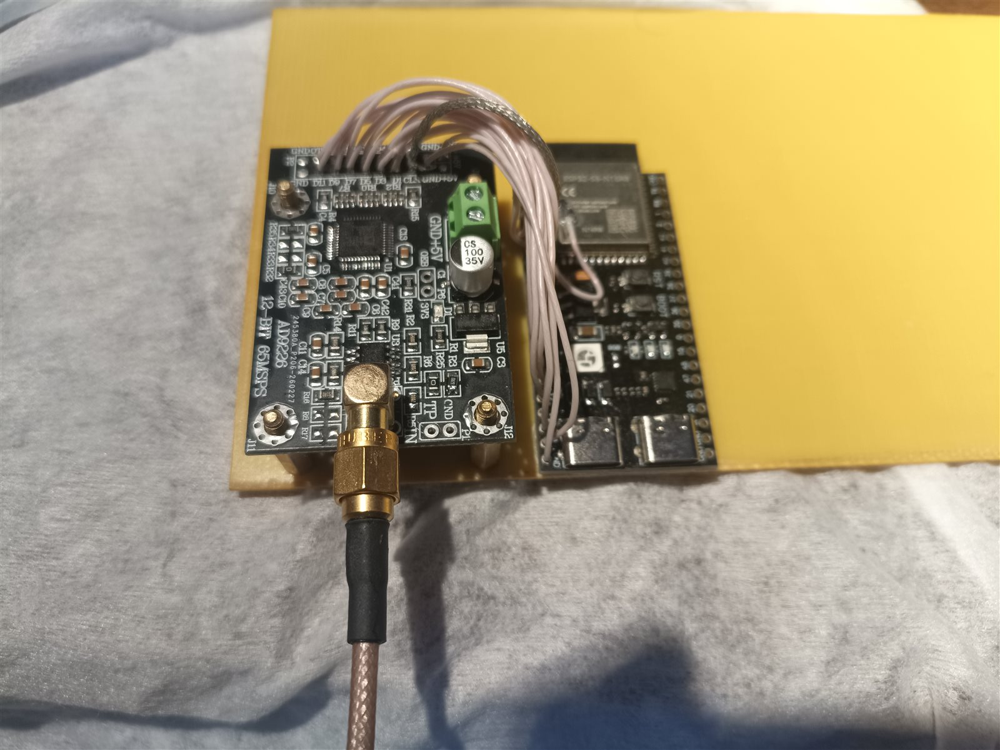
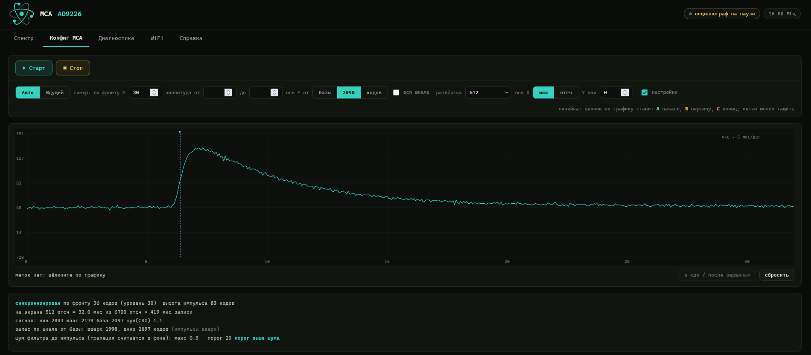
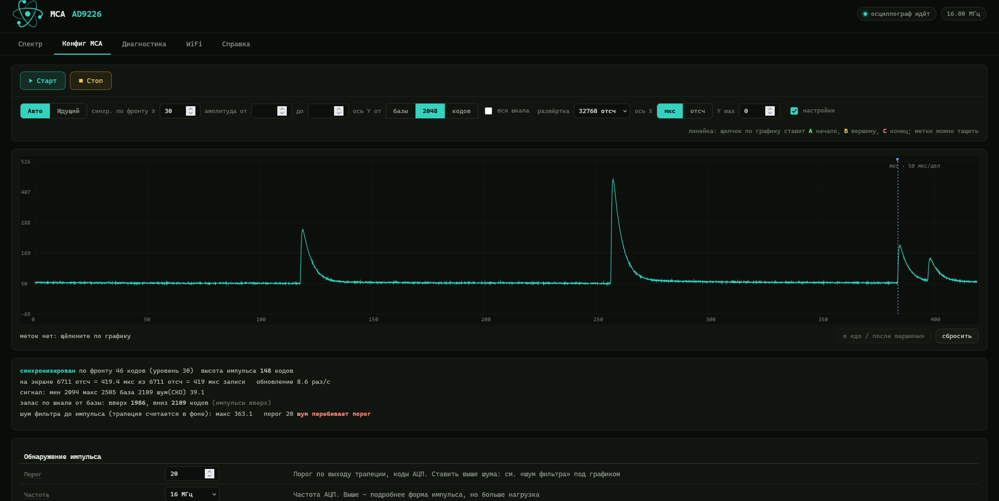
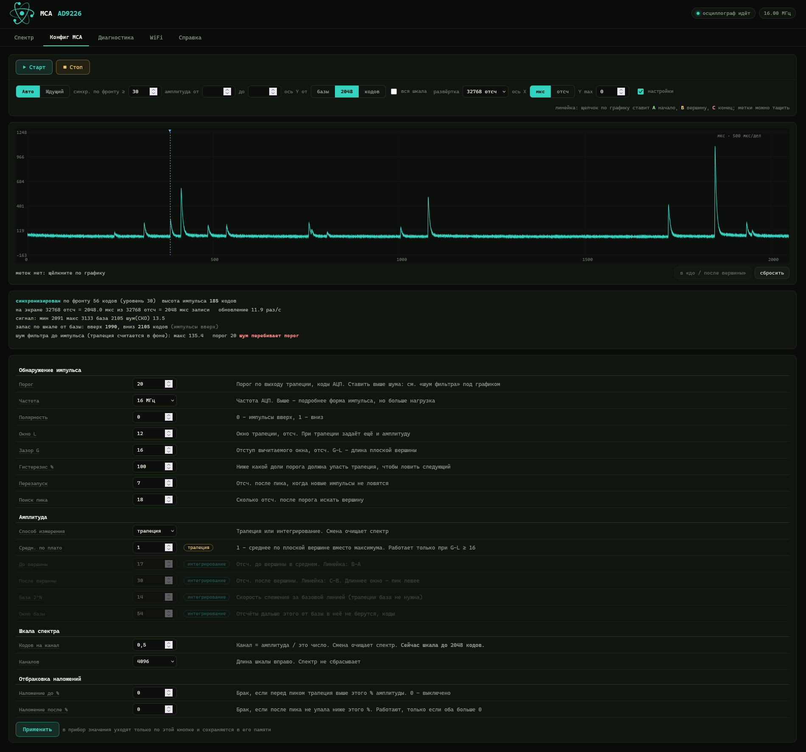

# MCA на ESP32-S3 + AD9226

**🇷🇺 Русский** · [🇬🇧 English](README.en.md) ·
[сайт проекта](https://qsxft446.github.io/esp32-Multi-Channel-Analyzer/)

*Open source DIY gamma spectrometer / multichannel analyzer (MCA) on ESP32-S3
and a 12-bit AD9226 ADC — [documentation in English](README.en.md).*

Многоканальный анализатор импульсов (гамма-спектрометр) на ESP32-S3-N16R8
и 12-битной плате АЦП AD9226. Поток АЦП забирает аппаратура (LCD_CAM +
GDMA), обработку ведёт второе ядро, управление и графики — через
веб-страницу по сети.

**Эта копия — под плату Waveshare ESP32-S3-ETH** (ESP32-S3R8, W5500 на
плате). Распиновка в разделе «Подключение» — для неё. Прибор работает
**только по Ethernet** с питанием по PoE: WiFi в этой прошивке нет, такт
АЦП делает блок камеры (CAM_CLK, см. «Частоты АЦП»).

ESP-IDF 5.4.4.



*Спектр: 2 мин 11 с набора, 6705 имп/с, мёртвое время 1.1 %, CLK 16 МГц,
4096 каналов. Выделен пик: центр 665 канал, ширина 45.7 канала,
разрешение 6.88 %.*



*Макет: плата AD9226 и плата с модулем ESP32-S3-N16R8, данные и CLK —
проводами.*

## Сборка и прошивка

```
idf.py set-target esp32s3
idf.py build
idf.py -p COM3 flash monitor
```

### Обновление по сети

Прошивка с разметкой из двух слотов (`partitions.csv`) принимает новую
версию по сети. **Первый раз — по USB**: прежняя разметка была с одним
слотом. Настройки при этом сохраняются — раздел `nvs`
остался на прежнем месте.

Дальше — без провода, любым из способов:

- страница «Сеть», блок «Прошивка»: выбрать `build/esp32_mca.bin`,
  «Загрузить и перезапустить»;
- `python tools/ota.py <ip>` — шлёт `build/esp32_mca.bin`, ждёт
  перезапуска и проверяет, что работает новый слот;
- `curl --data-binary @build/esp32_mca.bin http://<ip>/ota`.

До записи прибор проверяет, что файл — образ для ESP32-S3 этой же
программы (загрузчик, таблицу разделов и чужие файлы отклоняет), а после
записи — контрольную сумму всего образа. Запись идёт в свободный слот,
рабочий не трогается.

**Откат.** Новая прошивка считается рабочей после первого запроса к
`/stat` (его шлёт открытая страница) или `/ota`. Если до этого прибор
перезагрузился — упал, завис, не вышел в сеть, — загрузчик сам вернёт
прежнюю прошивку, а в консоли будет `прошивка в слоте … не подтвердилась
и была заменена прежней (откат)`.

`GET /ota` — версия, слот, состояние и причина последнего сброса
(`reset`: `poweron`, `usb`, `sw`, `panic`, `task_wdt`, `brownout` …) с
временем работы `up`: так по сети видно, перезагружался ли прибор сам.

**Защиты паролем нет**: прошить прибор может любой, кто видит его в
сети, — как и поменять остальные настройки. Держите прибор в своей сети.

**Сеть.** Подключите плату кабелем к сети с DHCP (питание — по PoE или
от USB). Адрес выдаёт роутер, он печатается в консоли:
`Ethernet подключён: http://<ip>/`. WiFi в этой прошивке нет, поэтому
без адреса по DHCP прибор по сети недоступен — адрес и ошибки смотрите
в консоли по USB.

## Подключение

Плата AD9226 (разъём P2) → Waveshare ESP32-S3-ETH. «Контакт» — номер на
гребёнке по схеме Waveshare: 1–20 — ряд от GPIO20, 21–40 — ряд от VBUS.

| ESP32-S3 | Контакт | Сигнал | P2 |
|---|---|---|---|
| GPIO38 | 14 | DATA0 | 5 |
| GPIO39 | 12 | DATA1 | 8 |
| GPIO40 | 11 | DATA2 | 7 |
| GPIO41 | 10 | DATA3 | 10 |
| GPIO42 | 9 | DATA4 | 9 |
| GPIO47 | 5 | DATA5 | 12 |
| GPIO48 | 4 | DATA6 | 11 |
| GPIO1 | 25 | DATA7 | 14 |
| GPIO2 | 26 | DATA8 | 13 |
| GPIO15 | 29 | DATA9 | 16 |
| GPIO17 | 34 | DATA10 | 15 |
| GPIO21 | 35 | DATA11 | 18 |
| GPIO3 | 27 | DATA12/OTR | 17 |
| GPIO16 | 32 | **CLK (выход)** | 6 |

Питание +5 В на пины 1–2 (с ESP32-S3-ETH — VBUS, контакт 40, при питании
от USB), земля на 3/4/19/20 и отдельный короткий толстый земляной провод
между платами (GND платы — контакты 3, 8, 13, 18, 23, 28, 33, 38).

**Линии данных идут по обоим рядам гребёнки:** подряд свободных выводов на
этой плате нет. GPIO4–7 заняты слотом microSD, 9–14 — W5500, 33–37 —
Octal PSRAM чипа, 19–20 — USB, 43–44 — UART0 (эмуляция MCA), 0/45/46 —
выводы загрузки. OTR — на GPIO3: этот вывод загрузки выбирает источник
JTAG только при прожжённом eFuse, иначе уровень на нём при старте ни на
что не влияет. Самому LCD_CAM порядок линий безразличен, проверка линий
данных в диагностике собирает слово по списку `MCA_DATA_PINS`.

**Перемычка CLK → PCLK не нужна.** Захват тактируется с той же ножки
GPIO16, на которую выдаётся CLK: у вывода включён ещё и вход, и через
GPIO-матрицу он заведён на PCLK камерного интерфейса. Это та же точка,
куда раньше приходила перемычка, — у самой ножки, до резистора. Чтобы
вернуть перемычку, в `main/mca_config.h` укажите отдельный
`PIN_CAM_PCLK_IN`, например 18 (контакт 31, рядом с GPIO16).

### Как вести CLK

```
GPIO16 ──[ 47 Ом ]──── провод CLK ──────── CLK  (AD9226)
                       провод GND ──────── GND  (AD9226)
                       (скрутить вместе)
```

- На АЦП уходит один провод CLK. Два длинных провода к одной точке CLK
  на плате АЦП образуют петлю — готовую антенну.
- Резистор 33–68 Ом последовательно, **у самой ножки** GPIO16: PCLK
  читается с ножки, то есть до резистора. Если взять PCLK после
  резистора (так было бы с перемычкой не в том месте), на фронте
  появится ступенька и захват может срабатывать дважды за такт.
- Провод CLK скручен с проводом земли; всё короткое и подальше от
  антенны модуля (конец модуля без экрана).

Это про чистоту такта у АЦП. На платах с WiFi проводка CLK важна ещё и
для связи — см. «Помехи от CLK в WiFi».

## Ethernet (WIZnet W5500)

На ESP32-S3-ETH чип W5500 распаян на плате, подключать ничего не нужно.
Это **единственный путь к прибору**: WiFi в этой прошивке нет (ни точки
доступа, ни клиента — радио не включается), питание — по PoE.

| W5500 | ESP32-S3 |
|---|---|
| SCLK | GPIO13 |
| MOSI | GPIO11 |
| MISO | GPIO12 |
| SCS (CS) | GPIO14 |
| INT | GPIO10 |
| RST | GPIO9 |

Выводы — по схеме Waveshare, меняются в `main/mca_config.h` (`PIN_ETH_*`).
Шина SPI — 20 МГц. Адрес
приходит по DHCP и печатается в консоли: `Ethernet подключён: http://<ip>/`,
а также показывается на странице «Сеть».

Страница «Сеть» (`/net`, прежний адрес `/wifi` тоже работает) показывает
состояние Ethernet и обновление прошивки по сети. Если W5500 не ответил
при старте, в консоли будет `W5500 не отвечает - сети нет`.

## Эмуляция MCA по COM-порту (протокол shproto)

Прибор умеет отвечать на последовательном порту как MCA с бинарным
протоколом **shproto** — программы на ПК, работающие с такими
анализаторами (например, [BecqMoni](https://github.com/Am6er/BecqMoni)),
видят его как обычный анализатор.

- **Порт** — UART0: разъём «UART»/COM на плате (мост USB-UART), не
  встроенный USB. Параметры `8 N 1`.
- **Включение** — «Осциллограф» → настройки → «Эмуляция MCA на COM»:
  «выключена» или скорость `38400 | 115200 | 460800 | 600000 | 921600`.
  Действует сразу и сохраняется. Весь спектр за секунду успевает уйти
  только на 460800 и выше.
- **Консоль молчит**, пока эмуляция включена: сообщения прошивки на порт
  не идут (и на встроенный USB тоже). Сообщения загрузчика при сбросе
  всё равно выходят на 115200 — программы их пропускают. Прошивка через
  этот порт работает как обычно.
- **Команды:** `-inf`, `-cal` (40 регистров: чтение и запись, хранятся в
  памяти прибора; по умолчанию калибровки нет, серийник — из MAC),
  `-sta [сек] [-r] [-s]`, `-sto`, `-sho`, `-stt`, `-rst`, `-mode 0`,
  `-spd`, `-frq` (ближайшая большая частота из таблицы), `-reboot`.
  На каждую выполненную команду прибор отвечает текстом `-ok`, на `-sta`
  при 38400 и 115200 — `Warning: silent mode forced due to low interface
  speed-ok`: именно эти ответы ждёт BecqMoni при запуске набора (без них —
  «не удаётся прочитать данные из порта»). Команды разбираются и посреди
  выгрузки спектра, поэтому ответ приходит быстрее секунды на любой
  скорости. Заводские команды настройки (`-ris`, `-fall`, `-U`, `-V`,
  `-nos`, `-pileup`…) не выполняются, ответ — `-err not supported`:
  параметры обработки задаются на странице прибора.
- **Во время набора** каждую секунду — пакет статуса (время набора,
  загрузка, CPS, отброшенные импульсы — наложения и вышедшие за шкалу),
  затем весь спектр: 8192 канала пакетами по 64. `-sta` запускает набор
  спектра и на самом приборе, `-sto` — останавливает.
- **Мёртвое время.** Программы считают его как
  `(сумма спектра + отброшенные) · (RISE + FALL + 1) / F`. Прибор после
  каждого замеченного импульса глух на поиск вершины и перезапуск, поэтому
  в ответе `-inf` `RISE` = «Поиск пика», а `FALL` подобран так, чтобы
  `RISE + FALL + 1` было средним числом отсчётов мёртвого времени на
  импульс (по замеру; пока импульсов мало — «Перезапуск»). Живое время у
  программы тогда совпадает с прибором. В BecqMoni мёртвое время
  читается только кнопкой мёртвого времени в настройках прибора: сначала
  несколько секунд набора с источником, потом кнопка; после смены частоты
  АЦП или параметров обработки — нажать снова.
- **Каналов — как в настройке «Каналов» прибора (2048/4096/8192).**
  Протокол и программы всегда держат 8192 канала: BecqMoni хранит спектр
  в массиве на 8192 и сама складывает по `8192/N` соседних, чтобы получить
  N каналов из своих настроек. Поэтому при N меньше 8192 прибор растягивает
  каждый свой канал на `8192/N` соседних, деля счёт без остатка, — и
  BecqMoni с **тем же N в настройках** складывает их обратно в ровно
  каналы прибора. Выставьте в BecqMoni то же число каналов, что на
  приборе: при несовпадении спектр будет растянут или сжат. События выше
  шкалы (каналы от N до 8191) идут в «отброшенные», чтобы «всего
  импульсов» и мёртвое время у программы остались верными.

Проверка с ПК: `python tools/emu_check.py COM3 600000` — шлёт команды и
разбирает ответы по правилам эталонного протокола (CRC, экранирование,
формат `-inf`/`-cal`, порядок статуса и спектра) и BecqMoni (ответы на
команды).

## Веб-интерфейс

- **Язык** — русский или английский, кнопки RU / EN в шапке рядом с
  частотой АЦП. Выбор запоминается в браузере; если выбора не было — по
  языку браузера (русский для `ru`, иначе английский). Сообщения прошивки
  в консоли — по-русски.
- **Спектр** — набор, лин/лог шкала, анализ выделенного пика (центр,
  ширина на полувысоте, разрешение), выгрузка файлом: XML
  (ResultDataFile, открывается в BecqMoni), CSV (канал, счёт),
  N42 (ANSI N42.42), SPE (SpectraLine). Под галочкой «настройки» — та же
  таблица параметров обработки, что на «Осциллографе»: их можно менять прямо
  во время набора и смотреть, как меняется спектр.
- **Настройки обработки.** Наверху таблицы — частота, порог, полярность
  и шкала спектра; остальное (окна трапеции, способ измерения,
  отбраковка наложений, эмуляция MCA) свёрнуто в «Дополнительно», браузер
  помнит, раскрыт ли блок. Окна L, G, поиск и перезапуск — в отсчётах.
  Их можно не трогать: наборы по 5 минут на 16 МГц с L = 14, 20 и 28
  отсчётов дали на пике ~358 одинаковое разрешение 6.9–7.0 % — шум
  трапеции на этой плате много меньше ширины пиков, и разрешение задаёт
  детектор.
- **Мониторинг CPS** — там же, под спектром: текущий CPS, средний по всей
  истории с погрешностью, последний интервал, график по интервалам
  усреднения со скользящим средним, таблица интервалов и выгрузка CSV.
  График показывает окно по времени — по умолчанию последние 30 с (выбор
  «окно»: 30 с … 6 ч) — и едет за новыми данными; колесо — масштаб,
  перетаскивание — сдвиг в прошлое (там окно стоит на месте), двойной
  щелчок — обратно к окну и текущему моменту. Раньше по умолчанию
  показывалась вся история, и график сжимался по мере накопления.
  История — кольцо на 6 часов по секунде в PSRAM прибора (~216 КБ,
  `main/mca_hist.c`): копится, пока идёт набор спектра, даже при закрытой
  странице; страница дочитывает только новые отсчёты. CPS интервала —
  импульсы, делённые на время, пока реально шёл набор (без потерянных
  чанков). «Очистить историю» не трогает спектр, «Сброс» — историю.
- **Часы прибора** — своих часов реального времени нет. Время берётся по
  SNTP (`pool.ntp.org`), если есть выход в интернет; иначе любая открытая
  страница отдаёт прибору время браузера, когда часы не заданы или ушли
  больше чем на 2 с (и повторяет раз в час). Время и откуда оно — в
  заголовке мониторинга; выгрузка спектра без времени от страницы берёт
  его из часов прибора.
- **Осциллограф** — синхронизация по фронту (авто и
  ждущий режимы, развёртка 64–32768 отсчётов, синхронизация по
  амплитуде — «амплитуда от–до»: показывать только импульсы с высотой
  над базой в заданном диапазоне кодов АЦП, ось X в мкс или в отсчётах
  от момента синхронизации), линейка с метками A/B/C (фронт, вершина,
  конец импульса — переносятся в параметры интегрирования) и таблица
  всех настроек обработки с пометками, к какому способу измерения
  относится параметр.
- **Масштаб осциллографа «кодов/клетку»** — как на обычном осциллографе:
  авто или 1, 2, 5 … 500 кодов АЦП на клетку, клеток 8. База стоит на
  первой линии снизу (при импульсах вниз — сверху), масштаб от кадра к
  кадру не меняется, поэтому можно рассмотреть шум базы в несколько
  кодов. Импульс выше экрана обрезается, у края пишется, насколько он
  вышел. Выбор помнит браузер.
- **«Зафиксировать базу»** — запоминает текущий уровень базы, и дальше
  осциллограф рисует от него, а не от базы каждого кадра: база на экране
  неподвижна, а её медленный уход виден под графиком как «сдвиг».
  Повторное нажатие возвращает измерение по кадрам.
- **Старт/Стоп относятся к открытой вкладке:** на «Спектре» — набор
  спектра (там же «Сброс», строка статуса и время набора/CPS/события;
  время идёт только пока спектр набирается), на «Осциллографе» — только
  осциллограф: пауза держит последний кадр и не трогает набор спектра.
  Захват АЦП прошивка включает сама, когда он нужен открытой вкладке.
- **Диагностика** — галочка «диагностика» рядом с «настройки» на обеих
  вкладках (отдельной страницы больше нет): поток отсчётов и его реальная скорость,
  побитовая статистика линий данных, профиль за последнюю секунду (в том
  числе занятость обработки и такты процессора на отсчёт по этапам —
  копия, разность, порог и события — против бюджета 240 МГц / частота),
  журнал потерь чанков с режимом прибора, проверка линий данных.



*Осциллограф на паузе, развёртка 512 отсчётов (32 мкс при 16 МГц):
одиночный импульс высотой 83 кода, шум базы 1.1 кода СКО.*



*Около 420 мкс: импульсы разной высоты, справа — наложение двух
импульсов подряд.*



*Развёртка 32768 отсчётов (2 мс при 16 МГц) и таблица настроек
обработки: параметры другого способа измерения приглушены.*

## Устройство

**Захват.** LCD_CAM в камерном режиме + GDMA, кольцо из 16 буферов по
2046 отсчётов. Размер — почти предел: поле длины в дескрипторе GDMA
12-битное (до 4095 байт). При 8192 байтах маска давала ноль, контроллер
получал буфер нулевого размера и молча не выдавал ни одного чанка.
Глубина очереди равна числу буферов: номер в более глубокой очереди
указывал бы на уже перезаписанный буфер.

**Ядра.** Ядро 1 — задача обработки (`dsp`). Ядро 0 — сеть (W5500,
TCP/IP), веб-сервер и прерывание захвата.

**Обработка.** Рекурсивная трапеция. Разность окон считается векторными
командами ESP32-S3 (PIE) по 8 отсчётов, при старте — самопроверка
против обычного кода; не прошла — работает обычный код. Событие ищется
по выходу трапеции, амплитуда — по вершине трапеции или интегрированием
отсчётов вокруг вершины за вычетом базовой линии. Отбраковка наложений,
мёртвое время, гистерезис. Гистограмма — 8192 канала в PSRAM, на экран
идёт 2048/4096/8192; «Кодов на канал» задаёт масштаб.

**Режим работает только над тем, что открыто:** в осциллографе спектр не
считается.

### Частоты АЦП

В этой копии CLK делает блок камеры (CAM_CLK, `MCA_CLK_GEN_CAM 1`)
целыми делителями от 160 и 240 МГц: 1, 2, 4, 5, 6.67, 8, 8.89, 10, 11.43,
12, 13.33, 15, 16, 17.14 и 20 МГц. LEDC (`MCA_CLK_GEN_CAM 0`, только
80/K) на этой плате на 16 МГц портит данные — см. «Генератор CLK от
блока камеры».

Замер на этой плате (2026-10-28, ~3500 имп/с, по 5 с на частоту): в
режиме спектра задача обработки занимает ~72 % ядра 1 на 16 МГц и ~89 %
на 20 МГц, потерь чанков нет; нагрузка растёт пропорционально частоте и
со счётом. В осциллографе на 20 МГц очередь доходит до 16/16 и бывают
потери (на кадрах, где снимается окно). Оценка горячего цикла
(`tools/hotloop.py`): ~5.4 такта на отсчёт в ожидании события (1.75 —
векторная разность, 3.6 — поиск).

Список частот страница получает от прошивки (`/cfg`, поле `fl`), свой у
каждого генератора CLK. Частота хранится в памяти прибора в герцах.

## Найденное при отладке

### Помехи от CLK в WiFi

*К этой копии не относится: WiFi в ней нет. Раздел — из основного
проекта, для плат с WiFi.*

**Симптом.** На 16 МГц обновление осциллографа шло волнами, ответы
`/scope` доходили до 1–3 с, пинг до прибора прыгал до 350 мс. Чем длиннее
развёртка, тем хуже.

**Что показали опыты** (профиль в консоли, см. ниже):

| Опыт | Результат |
|---|---|
| 16 МГц, захват идёт | ядро 1 занято на 3 %, потерь нет — а связь рвётся |
| 16 МГц, **захват остановлен**, ядро 0 занято на 2–4 % | связь всё равно рвётся |
| только CLK сменили на 13.33 МГц | через секунду `/scope` 10 раз/с по 10–16 мс |
| только канал роутера 10 → 6 | заметно лучше: 9–10 раз/с по 45–98 мс |
| 16 МГц, канал роутера 1 | «вообще всё плохо» |
| 16 МГц, канал роутера 8 | нормально |

То есть процессор и программа ни при чём: мешает сигнал CLK. Прямоугольный
сигнал содержит все кратные частоты; 154 × 16 МГц = 2464 МГц — это внутри
канала 10 (2457 ± 8.75 МГц). Провода CLK — антенна в сантиметрах от
антенны модуля, а приёмник WiFi очень чувствителен: часть пакетов
теряется, TCP ждёт повторов. Длинная развёртка — больше пакетов в ответе,
больше шансов потерять хотя бы один.

**От чего зависит.** Важна не частота АЦП сама по себе, а **пара «частота
АЦП + канал роутера»**: попадает ли сильная гармоника в полосу канала
(центр 2407 + 5·N МГц, ±8.75 МГц). Сила гармоники номер n у
прямоугольного сигнала со скважностью D пропорциональна |sin(π·n·D)|/n:

- у 16 МГц (80/5) скважность 40/60, и гармоники чередуются по силе:
  2416 МГц (канал 1) и 2464 МГц (канал 10) — сильные, 2432 и 2448 МГц
  (каналы 4–9) — примерно на 40 % слабее, 2400 и 2480 МГц — нулевые.
  Отсюда ровно то, что видно на опыте: каналы 1 и 10 плохие, 6 и 8 —
  нормальные;
- у 13.33 МГц (80/6) меандр 50 %, чётные гармоники почти исчезают. В
  полосу каналов 4, 9 и 10 попадают только чётные — там чисто. Зато на
  остальных каналах в полосе сильная нечётная гармоника, и 13.33 МГц там
  хуже, чем 16 МГц.

То же видно у других проектов на ESP32: такт 5/10/20 МГц на выводе
портит WiFi, 8 МГц — нет ([arduino-esp32 #5834](https://github.com/espressif/arduino-esp32/issues/5834));
такт камеры 20 МГц — 50 потерь пинга из 60, на 2 МГц — ни одного повтора
TCP ([AI-on-the-edge #3558](https://github.com/jomjol/AI-on-the-edge-device/issues/3558));
у одних лечит 20 МГц, у других — 8 МГц ([ESP32-HUB75 #258](https://github.com/mrcodetastic/ESP32-HUB75-MatrixPanel-DMA/discussions/258)).
Последнее не противоречие: у всех разные каналы роутера.

**Какую пару выбрать.** Расчёт по формуле выше, откалиброванный по
замерам на 16 МГц: ✓ — чисто, ~ — работать можно (как 16 МГц на каналах
6 и 8), ✗ — связь рвётся (как 16 МГц на каналах 1 и 10).

| АЦП, МГц | 1 | 2 | 3 | 4 | 5 | 6 | 7 | 8 | 9 | 10 | 11 | 12 | 13 |
|---|---|---|---|---|---|---|---|---|---|---|---|---|---|
| 1, 2 | ✓ | ✓ | ✓ | ✓ | ✓ | ✓ | ✓ | ✓ | ✓ | ✓ | ✓ | ✓ | ✓ |
| 4 – 10 | ~ | ~ | ~ | ~ | ~ | ~ | ~ | ~ | ~ | ~ | ~ | ~ | ~ |
| 11.43 | ✗ | ✗ | ~ | ~ | ~ | ~ | ~ | ~ | ~ | ~ | ✗ | ✗ | ✗ |
| 13.33 | ✗ | ✗ | ✗ | ✓ | ✗ | ✗ | ✗ | ✗ | ✓ | ✓ | ✗ | ✗ | ✗ |
| 16 | ✗ | ✗ | ✗ | ~ | ~ | ~ | ~ | ~ | ~ | ✗ | ✗ | ✗ | ✗ |
| 20 (осциллограф) | ✗ | ✗ | ✗ | ✗ | ✓ | ✓ | ✓ | ✓ | ✗ | ✗ | ✗ | ✗ | ✓ |

Фронты в расчёте идеальные; в жизни высокие гармоники ещё слабее,
поэтому низкие частоты безопаснее, чем в таблице. Проверены на приборе:
16 МГц на каналах 1, 6, 8, 10 и 13.33 МГц на канале 10.

### Смените канал WiFi на роутере

*К этой копии не относится: WiFi в ней нет. Раздел — из основного
проекта, для плат с WiFi.*

Это самый быстрый и бесплатный способ: на приборе с 16 МГц связь,
которая на канале 1 не работала вовсе, на канале 8 стала нормальной.

1. Узнайте, на каком канале роутер сейчас: при подключении прибор пишет
   в консоль `STA подключена: http://<ip>/ канал N (МГц)`.
2. Откройте настройки роутера в браузере — это адрес шлюза (обычно
   `192.168.0.1` или `192.168.1.1`, прибор печатает его в консоли как
   `gw`).
3. Раздел «Беспроводная сеть» / Wireless, диапазон 2.4 ГГц → «Канал»:
   вместо «Авто» поставьте **фиксированный** канал из таблицы под вашу
   частоту АЦП. Например, для 16 МГц — канал 8 (подходят 4–9), для
   13.33 МГц — канал 9 или 10 (или 4).
4. Ширину канала лучше поставить **20 МГц**, а не 40 и не «авто»: чем шире
   полоса, тем больше гармоник в неё попадает.
5. Сохраните. Прибор переподключится сам, в консоли будет новый канал.
   Точка доступа `MCA-Setup` сама переходит на тот же канал.

Почему не «Авто»: роутер может в любой момент сам перейти на канал, где
гармоника CLK глушит связь, и прибор «вдруг» перестанет отвечать. Если
подходящих каналов несколько, берите тот, где меньше соседних сетей.
Смена канала затронет все устройства в этой сети — они переподключатся
сами.

### Что ещё помогает (от сильного к слабому)

*К этой копии не относится: WiFi в ней нет. Раздел — из основного
проекта, для плат с WiFi.*

1. Проводка CLK — см. «Как вести CLK»: короткий провод, скрученный с
   землёй, резистор последовательно у GPIO16. Замедление фронтов сильнее
   всего гасит именно высокие гармоники.
2. Модуль ESP32-S3 с разъёмом внешней антенны, антенна в 10–20 см от
   платы АЦП.
3. Экран из **фольгированного текстолита**, соединённый с землёй.
   Закрыть им сторону платы ESP32, где к выводам подходят провода данных
   и CLK, — так пучок проводов отделяется от антенны модуля. Важно:
   - **антенну не закрывать.** Это конец модуля без металлического
     экрана. Медь держать от неё не ближе ~15 мм, конец модуля с антенной
     должен выступать за край экрана. Металл рядом с антенной
     расстраивает её, и связь станет хуже, а не лучше;
   - **медь заземлить:** соединить с GND платы ESP32 коротким широким
     проводником, лучше в двух-трёх местах. Незаземлённая пластина на
     2.4 ГГц сама переизлучает помеху;
   - медью наружу или заклеить каптоновым скотчем, чтобы не замкнуть
     выводы;
   - ещё лучше — положить провода прямо на заземлённую медь: у провода,
     лежащего на земляной плоскости, петля тока маленькая, и он почти не
     излучает.

   На фото макета выше пучок проводов идёт дугой над модулем, рядом с
   антенной, — экран и разводка проводов в сторону от антенны должны
   заметно ослабить помеху.
4. Пара «частота + канал» из таблицы — обходит помеху, но не убирает её.

Энергосбережение WiFi на приборе уже выключено (`WIFI_PS_NONE`) — это
тоже советуют при таких помехах. Размытие спектра такта (частота такта
медленно «гуляет» на доли процента) — стандартный приём против помех, но
LEDC так не умеет; это возможно только с внешним генератором такта.

Не выяснено, как именно помеха попадает в приёмник — по воздуху или
через питание и землю. Меры одни и те же.

### Генератор CLK от блока камеры — в этой копии основной

В `adc_clk.c` есть второй генератор: выход CAM_CLK блока LCD_CAM,
целые делители от 160 и 240 МГц (до 20 МГц, в том числе 12, 15, 17.14).
Включается `MCA_CLK_GEN_CAM 1` в `mca_config.h`. Расчёт обещал, что на
17.14 МГц (240/14) канал 6 будет чистым — при условии меандра 50 %. На
деле при **остановленном** захвате пинг шёл по 0.3–1.25 с с потерями, и
интерфейс перестал открываться: гораздо хуже, чем 16 МГц от LEDC. Значит,
CAM_CLK — не ровный меандр (документация скважность этого выхода не
обещает). Вернулись на LEDC. Это было на прежней плате с WiFi; в этой
копии WiFi нет, и CAM_CLK — основной генератор (`MCA_CLK_GEN_CAM 1`):
см. замер ниже.

**На Waveshare ESP32-S3-ETH 16 МГц от LEDC портит данные.** Замер по
сети, сырые кадры осциллографа при одной и той же проводке и сигнале:

| Генератор, частота | Замеров | Скачки > 200 кодов | Отсчёты 0/4095 | OTR |
|---|---|---|---|---|
| LEDC, 1–13.33 и 20 МГц | 11 | 0–0.02 % | 0 | молчит |
| LEDC, 16 МГц (80/5, скважность 40/60) | 7 | 7–47 % | 2–16 % | срабатывает |
| CAM_CLK, 16 МГц (160/10) | 5 | 0 % | 0 | молчит |
| CAM_CLK, 8–20 МГц | 5 | 0 % | 0 | молчит |

OTR выдаёт сам AD9226 и читается с GPIO мимо камерного интерфейса,
поэтому ломается преобразование в АЦП, а не захват. Нечётные делители
LEDC 80/7 и 80/9 (тоже не 50 %) работают чисто — чем именно плох такт
16 МГц от LEDC, не выяснено: нужен осциллограф на ножке CLK у AD9226.

При смене генератора учтено: сброс LCD_CAM останавливает и этот такт,
поэтому источник и делитель модуля задаёт только `adc_clk`
(`adc_clk_cam_apply`), а `adc_cap` зовёт его после сброса.

### Буфер отправки TCP

По умолчанию `CONFIG_LWIP_TCP_SND_BUF_DEFAULT` = 5760 байт (4 сегмента).
Ответ `/scope` в 16–32 КБ уходил за 6 обменов «пачка — подтверждение»,
а потерянный хвост стоил повтора по таймеру (1.5 с). Поставлено 16384 —
ответ за один-два обмена. Это предел, а не занятая заранее память.

### Осциллограф

- **Окно под развёртку: до 8192 — во внутренней памяти, длиннее — в
  PSRAM.** Прибор собирает ровно столько, сколько страница просит:
  развёртка плюс запас трапеции, из них до фронта — пятая часть экрана
  (раньше предыстория была всегда 6144 отсчёта). На 20 МГц с окнами в
  PSRAM терялись чанки — только в осциллографе и только во время
  запросов `/scope`: запись одного буфера захвата в окно занимала до
  0.9 мс при бюджете 0.1 мс. Кэш данных PSRAM — 32 КБ, окно — до 64 КБ,
  и веб в это же время читал оттуда снимок. Теперь два окна до 8400
  отсчётов (2 × 17 КБ) лежат во внутренней памяти, два полных — в PSRAM
  для развёрток 16384 и 32768; на них при 20 МГц потери возможны.
  (Когда-то окно уже переносили во внутреннюю память ради замираний
  страницы — тогда причиной оказались гармоники CLK в WiFi.)
- **Снимок уходит в сеть прямо из своего буфера**, без копии: пока ответ
  отправляется, новые кадры не публикуются, а следующее окно собирается в
  другом буфере.
- **Предыстория без копирования.** Раньше на каждый чанк копировалось до
  6 КБ, при бюджете 128 мкс на чанк при 16 МГц. Теперь хранятся указатели
  на четыре предыдущих буфера захвата (предыстория до 6144 отсчётов),
  копия — один раз при срабатывании. Фронт ищется, только когда
  предыстория набрана целиком, — иначе первые кадры после запуска
  захвата (он перезапускается при смене вкладки и после паузы) прыгали бы
  по экрану. Каждый запуск захвата отмечается как разрыв потока: фильтр
  спектра и предыстория осциллографа сбрасываются.
  Если очередь почти полна, срабатывание пропускается: иначе предыстория
  взялась бы из буфера, который DMA уже перезаписывает.
- **Поиск фронта шагом 4 + точное уточнение.** Вчетверо дешевле полного
  перебора, момент синхронизации тот же. Модель против полного перебора
  на 4000 случайных чанках: 0 расхождений на настоящих фронтах;
  отличия только там, где полный перебор срабатывал на выбросе шума
  короче 4 отсчётов.
- **Снимок без блокировки.** Веб копирует снимок под флагом «читаю»,
  публикация в это время буферы не меняет, а кадр просто пропускает.
  Раньше веб держал мьютекс на время копии, а задача обработки брала его
  на каждом чанке — отсюда были потери.
- **Синхронизация по амплитуде.** Срабатывание по-прежнему по фронту, но
  после него прибор меряет высоту импульса: максимум за 256 отсчётов
  после фронта минус среднее 64 отсчётов до него (коды АЦП, с учётом
  полярности). Вне диапазона «от–до» кадр отбрасывается, как только
  набрались эти 256 отсчётов, не дожидаясь конца окна, и прибор ждёт
  следующий фронт. Высота показанного импульса и число отброшенных с
  прошлого кадра выводятся под графиком.
- **Кадры идут по WebSocket (`/ws`) и сжаты без потерь.** Страница
  присылает туда настройки (развёртка, уровень, амплитуда, пауза), а
  прибор сам шлёт кадр, только когда снимок новый и предыдущий кадр ушёл,
  не чаще 20 раз в секунду. Раньше страница опрашивала `/scope` и в
  ждущем режиме снова и снова получала тот же кадр; на Ethernet (W5500)
  это было 3 Мбит/с на развёртке 16384 и 4 Мбит/с на 32768 — около
  предела модуля по SPI. Отсчёты передаются разностями по 4 бита
  (`main/scope_codec.c`): разность −7…7 — один полубайт, иначе выход и
  отсчёт целиком. На модели сигнала кадр меньше в 3.4–4 раза: 16384 —
  33 → 8 КБ, 32768 — 66 → 20 КБ. Сообщение режется на куски по 4 КБ, так
  что сжатие идёт на лету без большого буфера. При старте прибор
  проверяет сжатие на себе; не прошло — кадры идут без сжатия (страница
  понимает оба вида). Под графиком видно «поток … кбит/с» и чем он идёт.
- **Кадры идут одному окну — тому, где осциллограф запущен.** Страница
  шлёт настройки раз в 2 с, в том числе когда осциллограф у неё на паузе
  или открыт спектр. Раньше такая посылка из второго окна забирала поток
  себе и останавливала его: в окне, где смотрят, картинка замирала до
  2 с. Теперь окно на паузе поток не трогает, а новое подключение не
  перебивает идущий поток. Если осциллограф запущен сразу в двух окнах,
  кадры переходят между ними раз в 2 с — смотрите в одном.
- **Страница тоже рисует не чаще 20 раз в секунду**, на любой развёртке.
  Большие кадры приходят по TCP пачками; когда каждый рисовался сразу,
  браузер не успевал за 32768 точками, кадры копились, и обновление то
  разгонялось, то падало. Теперь кадр, пришедший раньше срока, ждёт, а
  следующий его заменяет — рисуется самый свежий. «Обновление … раз/с» —
  число нарисованных кадров за секунду.
- Если WebSocket не открылся, страница опрашивает `/scope`, как раньше:
  ответ двоичный (7 × int32 + отсчёты uint16), следующий запрос — сразу
  после отрисовки, не чаще раза в 50 мс. Прибор готовит снимки не чаще
  раза в 25 мс.

### Прочее

- Привязка задачи TCP/IP к ядру 0 сделала хуже: веб дольше ждал своё
  ядро. Оставлено без привязки, но задача обработки теперь с приоритетом
  19, выше TCP/IP (18): уходя на ядро 1, TCP/IP вытесняла обработку
  (была 10), а запас очереди захвата на 20 МГц всего 1.6 мс.
- Статистика и параметры обработки — под спин-блокировкой, а не под
  мьютексом. «Применить» и «Сброс» держали мьютекс, пока чистили
  гистограмму в PSRAM и печатали в консоль, и задача обработки ждала
  миллисекунды — верные потери. Теперь очистку спектра и перезапуск
  фильтра выполняет сама задача обработки, гистограмму — кусками по 1024
  канала на чанк; на эти ~0.8 мс потока спектр не набирается, и время
  набора за них не идёт. «Сброс» заодно обнуляет счётчик событий за
  шкалой, который раньше копился.
- Спектр читается без блокировки; события пишутся в гистограмму без
  мьютекса, накопленное сбрасывается раз в чанк.
- **Постоянные уровни GPIO-матрицы — из ESP-IDF, а не числами.** У
  ESP32-S3 постоянная единица — `0x38`, постоянный ноль — `0x3C`
  (`soc/esp32s3/include/soc/gpio_pins.h`). Раньше в прошивке стояло
  `0x30` — это ноль у классического ESP32, а у S3 обычная ножка
  GPIO48. «Постоянный ноль» на входах кадровой синхронизации и лишних
  линий данных на самом деле читал GPIO48. На плате автора она в покое
  в нуле, и всё работало случайно; на платах, где к GPIO48 подключён
  светодиод (ESP32-S3 Super Mini, Arduino Nano ESP32), камера не видела
  начала кадра, и при живом такте не приходило ни одного чанка. Нашли
  при повторении проекта. Теперь значения берутся из ESP-IDF, а сборка
  проверяет, что константа не совпадает с номером настоящей ножки.
  Неиспользуемые линии данных CAM прибиты к нулю, чтобы не ловили
  наводки; если ноль вдруг не ноль, это видно в диагностике (строка
  «старшие биты 12–15»).
- Скорости «в секунду» (частота отсчётов, CPS, чанки) считаются по
  фактически прошедшему времени: секундный тик идёт из главного цикла с
  самым низким приоритетом, и под нагрузкой ядра 0 (например, выгрузка
  спектра по COM) растягивался до 1.1–1.2 с, завышая скорость на 10–20 %.

## Диагностика в консоли

По умолчанию профиль в консоль не печатается — только строка
`потеряно чанков: N, при последней потере шёл /…`, и только в ту
секунду, когда потери были. Под галочкой «диагностика» на странице профиль виден
всегда. Включить печать: `#define MCA_PROF_LOG 1` в `main/mca_config.h`.
Тогда раз в секунду:

```
prof: q=4/16 work=0.90 wait=0.23 busy 75% lost=0 | sp 1x23 sc 10x14 st 1x1 | heap 125k/87k load 71% cps 2242
prof: cpu0 5% cpu1 86% | dsp(1) 85.4% httpd(0) 2.2% main(0) 0.9% tiT(*) 0.5%
```

| Поле | Смысл |
|---|---|
| `q` | пик очереди чанков; 16/16 — пойдут потери |
| `work` / `wait` | самая долгая обработка чанка / ожидание чанка, мс |
| `busy` | доля времени задачи обработки в работе, в любом режиме |
| `lost` | потеряно чанков за секунду |
| `sp`, `sc`, `st` | запросов `/spectrum`, `/scope`, `/stat` за секунду × самый долгий, мс |
| `heap` | свободная внутренняя память / её минимум за всё время |
| `load` | загрузка внутри обработки спектра |
| `cpu0`, `cpu1` | загрузка ядер по учёту FreeRTOS (время прерываний — в счёт прерванной задачи) |
| `задача(ядро)` | самые занятые задачи; `*` — без привязки к ядру |

На каждую потерю — строка `ПОТЕРЯ +n q=… шёл /ep Xms work=…`: какой
запрос обслуживался в этот момент и сколько он длился.

## Другие платы ESP32-S3

Прошивка собрана под ESP32-S3-N16R8 (DevKitC), но запускается и на
других платах с ESP32-S3:

- **Флеш.** В заголовке прошивки — 4 МБ: если записать больше, чем есть
  на плате, ESP-IDF останавливает запуск (`ESP_ERR_FLASH_SIZE_NOT_MATCH`).
  На 16 МБ при старте будет только предупреждение.
- **PSRAM.** Без неё или с другим типом (Quad, как у N4R2) прибор не
  падает, а работает без неё: нет истории CPS на 6 часов и развёрток
  осциллографа 16384 и 32768. Чтобы получить всё, укажите свой тип
  PSRAM в `idf.py menuconfig` (Component config → ESP PSRAM).
- **Выводы.** Эта копия разведена под Waveshare ESP32-S3-ETH (см.
  «Подключение»). Для другой платы выводы меняются в `main/mca_config.h`.
  Не берите GPIO0, 45, 46 (загрузка), 19–20 (USB), 26–37 (флеш и PSRAM на
  модулях с Octal PSRAM).

## Порядок отладки на новом железе

1. Частота 1–2 МГц, вкладка «Осциллограф», режим «Авто», Старт. На вход —
   что-то известное. Ждём осмысленную линию. Если данные нулевые —
   перемычки R32–R35 на плате AD9226. Если чанков
   нет при живом PCLK — не подходит режим управляющих сигналов камерного
   интерфейса: поля `s_mode` в `main/adc_cap.c`. На этой плате рабочий
   режим — все полярности прямые, кадровая синхронизация на постоянном
   нуле; его нашёл перебор всех 48 вариантов (вариант 16), после чего
   перебор из прошивки убран. Галочка «диагностика»: строка «старшие
   биты 12–15» должна быть 0, «Проверить линии данных» — D0–D11
   меняются.
2. Сигнал с ФЭУ: ровная база между импульсами, запас по шкале АЦП.
3. Поднимаем частоту ступенями, на каждой — осциллограф и `lost` в
   консоли (или под галочкой «диагностика»). Данные с рывками до 0 и
   4095 и срабатывающий OTR на одной частоте — такт до АЦП приходит
   плохим (так было с LEDC на 16 МГц, см. «Генератор CLK от блока
   камеры»).
4. Спектр: порог выше шума трапеции (строка «шум фильтра» под
   осциллографом), L и G по форме импульса, «Кодов на канал» — чтобы
   пики легли в шкалу.

## Инструменты (`tools/`)

- `test_dsp.py` — 10 уровней проверок обработки на модели, в том числе
  векторная версия против обычной, сжатие кадров осциллографа против
  расшифровщика страницы и разбивка истории CPS на интервалы (функции
  страницы гоняются в node). `python tools/test_dsp.py`.
- `dspmodel.py`, `scopemodel.py`, `scopecodec.py` — модели обработки,
  осциллографа и сжатия его кадров.
- `hotloop.py` — оценка тактов горячего цикла по дизассемблеру.
- `mkpage.py` — собирает `build/page_test.html` со страницей прибора и
  заглушками ответов; открыть:
  `python -m http.server 8777 --directory build`.
- `emu_check.py` — проверка эмуляции MCA на COM-порту с ПК
  (`python tools/emu_check.py COM3 600000`; `--selftest` — только
  проверка кодека).
- `check_i18n.py` — у каждой надписи страниц прибора есть английский
  вариант (`python tools/check_i18n.py`).
- `ota.py` — прошивка по сети (`python tools/ota.py <ip>`, см.
  «Обновление по сети»).
