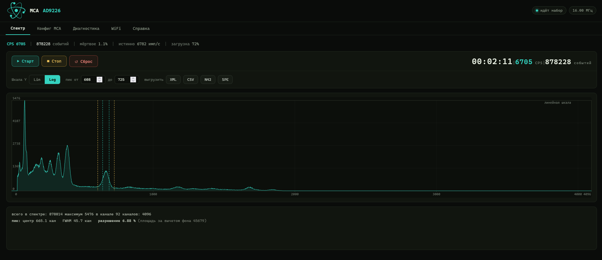
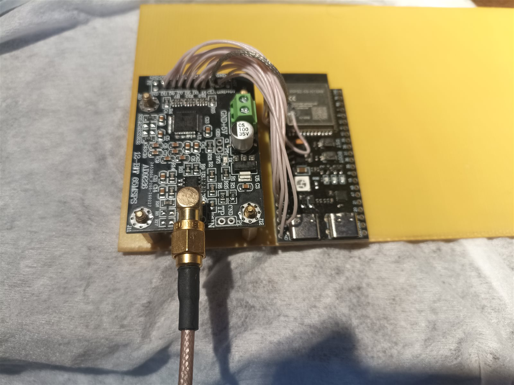
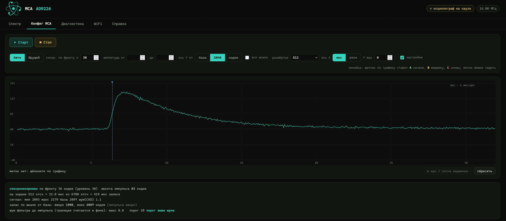
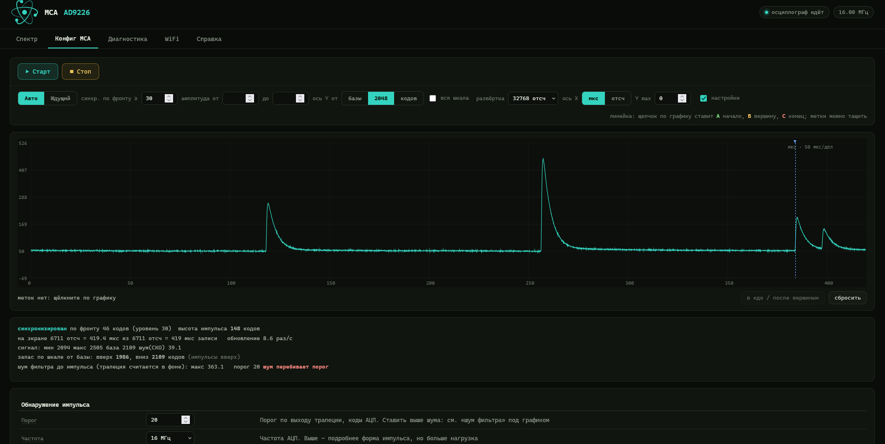
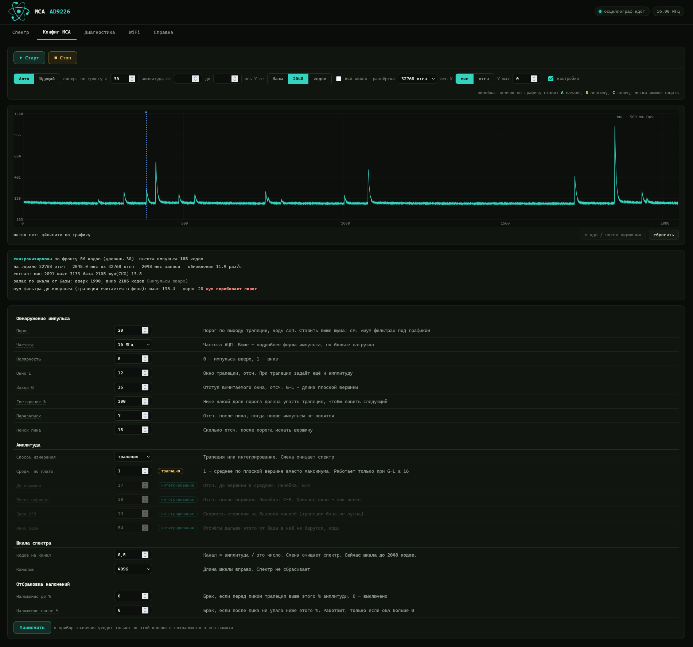
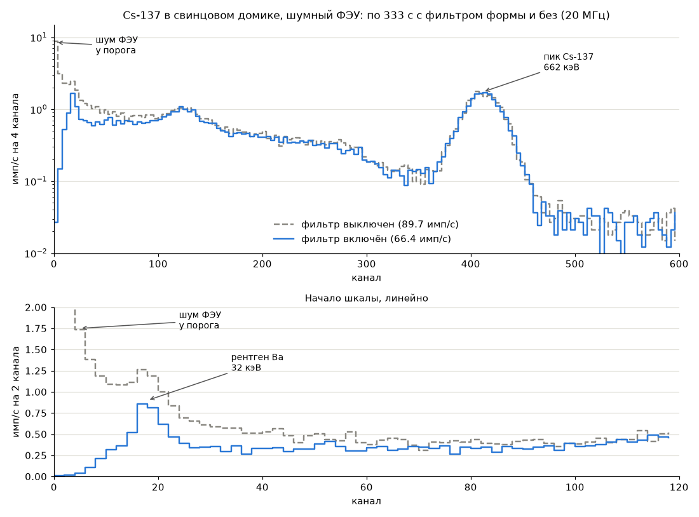
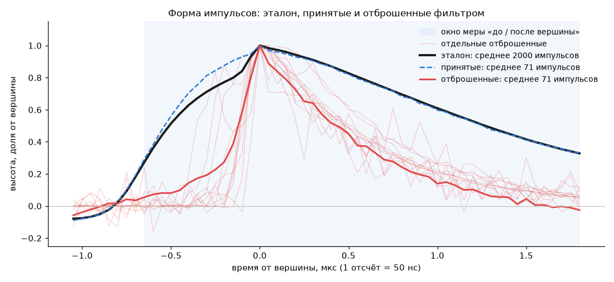

# MCA на ESP32-S3 + AD9226

**🇷🇺 Русский** · [🇬🇧 English](README.en.md) ·
[сайт проекта](https://qsxft446.github.io/esp32-Multi-Channel-Analyzer/)

*Open source DIY gamma spectrometer / multichannel analyzer (MCA) on ESP32-S3
and a 12-bit AD9226 ADC — [documentation in English](README.en.md).*

Многоканальный анализатор импульсов (гамма-спектрометр) на ESP32-S3-N16R8
и 12-битной плате АЦП AD9226. Поток АЦП забирает аппаратура (LCD_CAM +
GDMA), обработку ведёт второе ядро, управление и графики — через
веб-страницу по сети.

**Эта копия — под плату Waveshare ESP32-S3-ETH** (ESP32-S3R8, W5500 на
плате). Распиновка в разделе «Подключение» — для неё. Прибор работает
**только по Ethernet** с питанием по PoE: WiFi в этой прошивке нет, такт
АЦП делает блок камеры (CAM_CLK, см. «Частоты АЦП»).

ESP-IDF 5.4.4.



*Спектр: 2 мин 11 с набора, 6705 имп/с, мёртвое время 1.1 %, CLK 16 МГц,
4096 каналов. Выделен пик: центр 665 канал, ширина 45.7 канала,
разрешение 6.88 %.*



*Макет: плата AD9226 и плата с модулем ESP32-S3-N16R8, данные и CLK —
проводами.*

## Сборка и прошивка

```
idf.py set-target esp32s3
idf.py build
idf.py -p COM3 flash monitor
```

### Обновление по сети

Прошивка с разметкой из двух слотов (`partitions.csv`) принимает новую
версию по сети. **Первый раз — по USB**: прежняя разметка была с одним
слотом. Настройки при этом сохраняются — раздел `nvs`
остался на прежнем месте.

Дальше — без провода, любым из способов:

- страница «Настройки», раздел «Прошивка»: выбрать `build/esp32_mca.bin`,
  «Загрузить и перезапустить»;
- `python tools/ota.py <ip>` — шлёт `build/esp32_mca.bin`, ждёт
  перезапуска и проверяет, что работает новый слот;
- `curl --data-binary @build/esp32_mca.bin http://<ip>/ota`.

До записи прибор проверяет, что файл — образ для ESP32-S3 этой же
программы (загрузчик, таблицу разделов и чужие файлы отклоняет), а после
записи — контрольную сумму всего образа. Запись идёт в свободный слот,
рабочий не трогается.

**Откат.** Новая прошивка считается рабочей после первого запроса к
`/stat` (его шлёт открытая страница) или `/ota`. Если до этого прибор
перезагрузился — упал, завис, не вышел в сеть, — загрузчик сам вернёт
прежнюю прошивку, а в консоли будет `прошивка в слоте … не подтвердилась
и была заменена прежней (откат)`.

`GET /ota` — версия, слот, состояние и причина последнего сброса
(`reset`: `poweron`, `usb`, `sw`, `panic`, `task_wdt`, `brownout` …) с
временем работы `up`: так по сети видно, перезагружался ли прибор сам.

**Защиты паролем нет**: прошить прибор может любой, кто видит его в
сети, — как и поменять остальные настройки. Держите прибор в своей сети.

**Сеть.** Подключите плату кабелем к сети с DHCP (питание — по PoE или
от USB). Адрес выдаёт роутер, он печатается в консоли:
`Ethernet подключён: http://<ip>/`. WiFi в этой прошивке нет, поэтому
без адреса по DHCP прибор по сети недоступен — адрес и ошибки смотрите
в консоли по USB.

## Подключение

Плата AD9226 (разъём P2) → Waveshare ESP32-S3-ETH. «Контакт» — номер на
гребёнке по схеме Waveshare: 1–20 — ряд от GPIO20, 21–40 — ряд от VBUS.

| ESP32-S3 | Контакт | Сигнал | P2 |
|---|---|---|---|
| GPIO38 | 14 | DATA0 | 5 |
| GPIO39 | 12 | DATA1 | 8 |
| GPIO40 | 11 | DATA2 | 7 |
| GPIO41 | 10 | DATA3 | 10 |
| GPIO42 | 9 | DATA4 | 9 |
| GPIO47 | 5 | DATA5 | 12 |
| GPIO48 | 4 | DATA6 | 11 |
| GPIO1 | 25 | DATA7 | 14 |
| GPIO2 | 26 | DATA8 | 13 |
| GPIO15 | 29 | DATA9 | 16 |
| GPIO17 | 34 | DATA10 | 15 |
| GPIO21 | 35 | DATA11 | 18 |
| GPIO3 | 27 | DATA12/OTR | 17 |
| GPIO16 | 32 | **CLK (выход)** | 6 |

Питание +5 В на пины 1–2 (с ESP32-S3-ETH — VBUS, контакт 40, при питании
от USB), земля на 3/4/19/20 и отдельный короткий толстый земляной провод
между платами (GND платы — контакты 3, 8, 13, 18, 23, 28, 33, 38).

**Линии данных идут по обоим рядам гребёнки:** подряд свободных выводов на
этой плате нет. GPIO4–7 заняты слотом microSD, 9–14 — W5500, 33–37 —
Octal PSRAM чипа, 19–20 — USB, 43–44 — UART0 (эмуляция MCA), 0/45/46 —
выводы загрузки. OTR — на GPIO3: этот вывод загрузки выбирает источник
JTAG только при прожжённом eFuse, иначе уровень на нём при старте ни на
что не влияет. Самому LCD_CAM порядок линий безразличен, проверка линий
данных в диагностике собирает слово по списку `MCA_DATA_PINS`.

**Перемычка CLK → PCLK не нужна.** Захват тактируется с той же ножки
GPIO16, на которую выдаётся CLK: у вывода включён ещё и вход, и через
GPIO-матрицу он заведён на PCLK камерного интерфейса. Это та же точка,
куда раньше приходила перемычка, — у самой ножки, до резистора. Чтобы
вернуть перемычку, в `main/mca_config.h` укажите отдельный
`PIN_CAM_PCLK_IN`, например 18 (контакт 31, рядом с GPIO16).

### Как вести CLK

```
GPIO16 ──[ 47 Ом ]──── провод CLK ──────── CLK  (AD9226)
                       провод GND ──────── GND  (AD9226)
                       (скрутить вместе)
```

- На АЦП уходит один провод CLK. Два длинных провода к одной точке CLK
  на плате АЦП образуют петлю — готовую антенну.
- Резистор 33–68 Ом последовательно, **у самой ножки** GPIO16: PCLK
  читается с ножки, то есть до резистора. Если взять PCLK после
  резистора (так было бы с перемычкой не в том месте), на фронте
  появится ступенька и захват может срабатывать дважды за такт.
- Провод CLK скручен с проводом земли; всё короткое и подальше от
  антенны модуля (конец модуля без экрана).

Это про чистоту такта у АЦП. На платах с WiFi проводка CLK важна ещё и
для связи — см. «Помехи от CLK в WiFi».

## Ethernet (WIZnet W5500)

На ESP32-S3-ETH чип W5500 распаян на плате, подключать ничего не нужно.
Это **единственный путь к прибору**: WiFi в этой прошивке нет (ни точки
доступа, ни клиента — радио не включается), питание — по PoE.

| W5500 | ESP32-S3 |
|---|---|
| SCLK | GPIO13 |
| MOSI | GPIO11 |
| MISO | GPIO12 |
| SCS (CS) | GPIO14 |
| INT | GPIO10 |
| RST | GPIO9 |

Выводы — по схеме Waveshare, меняются в `main/mca_config.h` (`PIN_ETH_*`).
Шина SPI — 20 МГц. Адрес
приходит по DHCP и печатается в консоли: `Ethernet подключён: http://<ip>/`,
а также показывается на дисплее, если он подключён.

На странице «Настройки» (`/settings`, прежние адреса `/net` и `/wifi` тоже работают)
карточки «Сеть» (настройка адреса) и «Прошивка» (обновление по сети) стоят рядом. Если W5500 не ответил
при старте, в консоли будет `W5500 не отвечает - сети нет`.

**Статический адрес.** В разделе «Сеть» на странице «Настройки» —
«адрес от роутера (DHCP)» или «статический адрес» с полями адрес, маска,
шлюз, DNS (пустой DNS — равен шлюзу). Прибор проверяет маску и что шлюз
из той же подсети. Чтобы ошибкой не потерять прибор:

- новый статический адрес применяется сразу, но в память записывается
  только после подтверждения: страница сама открывается по новому адресу
  и подтверждает его. Если за 60 с подтверждения нет (адрес не из вашей
  сети, не тот шлюз) — прибор возвращается к прежней настройке;
  перезагрузка в эти 60 с тоже её вернёт;
- кнопка **BOOT** на плате, удержанная 5 с во время работы (не при
  включении), возвращает DHCP;
- текущий адрес виден на дисплее и в консоли.

## Дисплей SSD1306 128x64 (необязательно)

Маленький OLED-дисплей по I2C показывает:

- сверху — IP-адрес прибора (или `NO CABLE`, `WAITING FOR DHCP`,
  `NO ETHERNET`);
- строкой ниже — `RUN` (инверсией, идёт набор спектра) с текущим CPS,
  `STOP` или `SCOPE` (открыт осциллограф), справа — частота АЦП в МГц;
- внизу — график CPS по секундам набора за последние 128 с, новые
  справа; шкала от минимума до максимума на экране, оба подписаны.
  Пока набор стоит, график не движется.

Раскладка рассчитана и на двухцветный дисплей (верхние 16 строк жёлтые,
остальные голубые): обе строки текста целиком в жёлтой полосе, график —
в голубой. На одноцветном выглядит так же.

| Дисплей | ESP32-S3-ETH | Контакт |
|---|---|---|
| SDA | GPIO18 | 31 |
| SCL | GPIO46 | 6 |
| VCC | 3V3 | 36 |
| GND | GND | 38 |

Других свободных выводов на гребёнке нет. GPIO46 — вывод загрузки, но
при обычном старте его уровень ни на что не влияет; подтяжка на модуле
дисплея может помешать только входу в загрузчик кнопкой BOOT — тогда
отсоедините дисплей (прошивке по USB-кабелю и по сети он не мешает).
GPIO45 не годится: подтяжка при старте переключила бы питание флеша.

Адрес 0x3C или 0x3D прибор находит сам; дисплей можно подключить на
ходу — его ищут раз в 10 с. Выводы, частота шины (400 кГц) и поворот на
180° (`MCA_OLED_FLIP`) — в `main/mca_config.h`. Кадр рисуется и без
дисплея: `http://<ip>/oled.pbm` — то же, что на экране, картинкой.
Если картинка сдвинута на пару точек и по краю мусор — это дисплей
1,3" на контроллере SH1106, а не SSD1306.

## Эмуляция MCA по COM-порту (протокол shproto)

Прибор умеет отвечать на последовательном порту как MCA с бинарным
протоколом **shproto** — программы на ПК, работающие с такими
анализаторами (например, [BecqMoni](https://github.com/Am6er/BecqMoni)),
видят его как обычный анализатор.

- **Порт** — UART0: разъём «UART»/COM на плате (мост USB-UART), не
  встроенный USB. Параметры `8 N 1`.
- **Включение** — «Осциллограф» → настройки → «Эмуляция MCA на COM»:
  «выключена» или скорость `38400 | 115200 | 460800 | 600000 | 921600`.
  Действует сразу и сохраняется. Весь спектр за секунду успевает уйти
  только на 460800 и выше.
- **Консоль молчит**, пока эмуляция включена: сообщения прошивки на порт
  не идут (и на встроенный USB тоже). Сообщения загрузчика при сбросе
  всё равно выходят на 115200 — программы их пропускают. Прошивка через
  этот порт работает как обычно.
- **Команды:** `-inf`, `-cal` (40 регистров: чтение и запись, хранятся в
  памяти прибора; по умолчанию калибровки нет, серийник — из MAC),
  `-sta [сек] [-r] [-s]`, `-sto`, `-sho`, `-stt`, `-rst`, `-mode 0`,
  `-spd`, `-frq` (ближайшая большая частота из таблицы), `-reboot`.
  На каждую выполненную команду прибор отвечает текстом `-ok`, на `-sta`
  при 38400 и 115200 — `Warning: silent mode forced due to low interface
  speed-ok`: именно эти ответы ждёт BecqMoni при запуске набора (без них —
  «не удаётся прочитать данные из порта»). Команды разбираются и посреди
  выгрузки спектра, поэтому ответ приходит быстрее секунды на любой
  скорости. Заводские команды настройки (`-ris`, `-fall`, `-U`, `-V`,
  `-nos`, `-pileup`…) не выполняются, ответ — `-err not supported`:
  параметры обработки задаются на странице прибора.
- **Во время набора** каждую секунду — пакет статуса (время набора,
  загрузка обработки, CPS, отброшенные импульсы — наложения и вышедшие за шкалу),
  затем весь спектр: 8192 канала пакетами по 64. `-sta` запускает набор
  спектра и на самом приборе, `-sto` — останавливает.
- **Мёртвое время.** Программы считают его как
  `(сумма спектра + отброшенные) · (RISE + FALL + 1) / F`. Прибор после
  каждого замеченного импульса глух на поиск вершины и перезапуск, поэтому
  в ответе `-inf` `RISE` = «Поиск пика», а `FALL` подобран так, чтобы
  `RISE + FALL + 1` было средним числом отсчётов мёртвого времени на
  импульс (по замеру; пока импульсов мало — «Перезапуск»). Живое время у
  программы тогда совпадает с прибором. В BecqMoni мёртвое время
  читается только кнопкой мёртвого времени в настройках прибора: сначала
  несколько секунд набора с источником, потом кнопка; после смены частоты
  АЦП или параметров обработки — нажать снова.
- **Каналов — как в настройке «Каналов» прибора (2048/4096/8192).**
  Протокол и программы всегда держат 8192 канала: BecqMoni хранит спектр
  в массиве на 8192 и сама складывает по `8192/N` соседних, чтобы получить
  N каналов из своих настроек. Поэтому при N меньше 8192 прибор растягивает
  каждый свой канал на `8192/N` соседних, деля счёт без остатка, — и
  BecqMoni с **тем же N в настройках** складывает их обратно в ровно
  каналы прибора. Выставьте в BecqMoni то же число каналов, что на
  приборе: при несовпадении спектр будет растянут или сжат. События выше
  шкалы (каналы от N до 8191) идут в «отброшенные», чтобы «всего
  импульсов» и мёртвое время у программы остались верными.

Проверка с ПК: `python tools/emu_check.py COM3 600000` — шлёт команды и
разбирает ответы по правилам эталонного протокола (CRC, экранирование,
формат `-inf`/`-cal`, порядок статуса и спектра) и BecqMoni (ответы на
команды).

## Веб-интерфейс

- **Язык** — русский или английский, кнопки RU / EN в шапке рядом с
  частотой АЦП. Выбор запоминается в браузере; если выбора не было — по
  языку браузера (русский для `ru`, иначе английский). Сообщения прошивки
  в консоли — по-русски.
- **Спектр** — набор, лин/лог шкала, анализ выделенного пика (центр,
  ширина на полувысоте, разрешение), выгрузка файлом: XML
  (ResultDataFile, открывается в BecqMoni), CSV (канал, счёт),
  N42 (ANSI N42.42), SPE (SpectraLine).
- **Настройки** — отдельная страница (ссылка вверху): разделы «Сеть»
  (адрес: DHCP или статический), «Прошивка» (версия и обновление по сети),
  и «Настройки АЦП». На вкладках «Спектр» и
  «Осциллограф» настроек и диагностики больше нет — осциллограф берёт
  нужные ему окна, порог и полярность у прибора сам, раз в 5 с.
- **Настройки АЦП.** Наверху таблицы — частота, порог, полярность и
  шкала спектра; остальное (окна трапеции, способ измерения, отбраковка
  наложений, эмуляция MCA) свёрнуто в «Дополнительно», браузер помнит,
  раскрыт ли блок. Окна L, G, поиск и перезапуск — в отсчётах. Их можно
  не трогать: наборы по 5 минут на 16 МГц с L = 14, 20 и 28 отсчётов
  дали на пике ~358 одинаковое разрешение 6.9–7.0 % — шум трапеции на
  этой плате много меньше ширины пиков, и разрешение задаёт детектор.
- **Фильтр формы импульса** — карточка на странице «Настройки»,
  включается по желанию, по умолчанию выключен: с хорошим ФЭУ и его
  родным питанием он не нужен. Мера формы — эффективная ширина импульса:
  площадь / высота в окне «до / после вершины» (те же два числа, что у
  интегрирования; при включённом фильтре в таблице они не приглушаются).
  У сцинтилляций она почти одна при любой энергии, шумовые всплески ФЭУ
  уже. «Набрать эталон» — при запущенном наборе (хватит и фона, с
  источником быстрее) прибор берёт
  2000 импульсов выше трёх порогов, медиана их ширины становится
  эталоном и сохраняется в памяти прибора. Фильтр отбрасывает импульсы,
  ширина которых дальше от эталона, чем «допуск» (по умолчанию 25 %).
  Эталон годится только для того окна и той частоты АЦП, на которых
  набран: сменились — фильтр пропускает всё, а карточка просит набрать
  эталон заново. Под кнопками два графика. «Эталонный импульс» — средняя
  форма импульсов набора (сохраняется в памяти прибора вместе с
  эталоном), поверх неё последний импульс в допуске (зелёный) и
  последний вне допуска (красный), каждый своей высотой к 1, с высотой и
  шириной; светлая полоса — окно меры. «Ширина импульсов» — гистограмма
  площадь / высота: зелёное в допуске, красное вне, полоса — эталон ±
  допуск, внизу доля вне допуска. С «Сброса» видно, сколько проверено и
  отброшено (`/stat`: `shchk`, `shrej`). На 20 МГц при ~5000 имп/с
  фильтр работает без потерь чанков, но запас ядра небольшой (замеры —
  «Найденное при отладке», «Фильтр формы импульса»).
- **Мониторинг CPS** — там же, под спектром: текущий CPS, средний по всей
  истории с погрешностью, последний интервал, график по интервалам
  усреднения со скользящим средним, таблица интервалов и выгрузка CSV.
  График показывает окно по времени — по умолчанию последние 30 с (выбор
  «окно»: 30 с … 6 ч) — и едет за новыми данными; колесо — масштаб,
  перетаскивание — сдвиг в прошлое (там окно стоит на месте), двойной
  щелчок — обратно к окну и текущему моменту. Раньше по умолчанию
  показывалась вся история, и график сжимался по мере накопления.
  История — кольцо на 6 часов по секунде в PSRAM прибора (~216 КБ,
  `main/mca_hist.c`): копится, пока идёт набор спектра, даже при закрытой
  странице; страница дочитывает только новые отсчёты. CPS интервала —
  импульсы, делённые на время, пока реально шёл набор (без потерянных
  чанков). «Очистить историю» не трогает спектр, «Сброс» — историю.
  Разрыв на графике — только там, где набора не было. Раньше график
  иногда рвался и посреди набора: время отсчёта считалось от момента
  каждого запроса страницы, задержка сети сдвигала соседние отсчёты, и
  секунда оставалась пустой. Теперь сдвиг часов прибора относительно
  браузера один на всю историю, а сам прибор помечает отсчёт плановым
  временем секундного тика — ровно через 1 с (раньше — моментом записи,
  который гулял на долю 100-мс шага главного цикла).
- **Часы прибора** — своих часов реального времени нет. Время берётся по
  SNTP (`pool.ntp.org`), если есть выход в интернет; иначе любая открытая
  страница отдаёт прибору время браузера, когда часы не заданы или ушли
  больше чем на 2 с (и повторяет раз в час). Время и откуда оно — в
  заголовке мониторинга; выгрузка спектра без времени от страницы берёт
  его из часов прибора.
- **Осциллограф** — синхронизация по фронту (авто и
  ждущий режимы, развёртка 64–32768 отсчётов, синхронизация по
  амплитуде — «амплитуда от–до»: показывать только импульсы с высотой
  над базой в заданном диапазоне кодов АЦП, ось X в мкс или в отсчётах
  от момента синхронизации), линейка с метками A/B/C (фронт, вершина,
  конец импульса; кнопка «задать до / после вершины» сразу пишет их в
  параметры интегрирования).
- **Масштаб осциллографа «кодов/клетку»** — как на обычном осциллографе:
  авто или 1, 2, 5 … 500 кодов АЦП на клетку, клеток 8. База стоит на
  первой линии снизу (при импульсах вниз — сверху), масштаб от кадра к
  кадру не меняется, поэтому можно рассмотреть шум базы в несколько
  кодов. Импульс выше экрана обрезается, у края пишется, насколько он
  вышел. Выбор помнит браузер.
- **«Зафиксировать базу»** — запоминает текущий уровень базы, и дальше
  осциллограф рисует от него, а не от базы каждого кадра: база на экране
  неподвижна, а её медленный уход виден под графиком как «сдвиг».
  Повторное нажатие возвращает измерение по кадрам.
- **Старт/Стоп относятся к открытой вкладке:** на «Спектре» — набор
  спектра (там же «Сброс», строка статуса и время набора/CPS/события;
  время идёт только пока спектр набирается), на «Осциллографе» — только
  осциллограф: пауза держит последний кадр. Набор и осциллограф вместе не
  идут — режим у прибора один. **Вкладки только переключают вид:**
  открыть «Осциллограф» не значит его запустить. «Старт» на нём при
  идущем наборе сначала предупреждает, что набор остановится (накопленный
  спектр сохраняется), и только после согласия останавливает набор и
  запускает осциллограф; «Старт» на «Спектре» возвращает прибор в набор.
  Раньше режим прибора менялся уже при открытии вкладки: осциллограф
  стартовал сам, а набор молча вставал. Подпись в шапке показывает, что
  прибор делает на самом деле.
- **Диагностика** — отдельная страница (`/diag`), две карточки:
  - **Лог прибора** — сообщения прошивки (ESP_LOG) с начала работы:
    прибор держит последние 256 строк в PSRAM (`main/mca_log.c`),
    страница дочитывает новые раз в секунду. Цвет по уровню: красные
    (с подсветкой строки) — ошибки, жёлтые — предупреждения, светлые —
    сообщения, серые — отладка. Тег окрашен по подсистеме: АЦП, сеть,
    прошивка, настройки, дисплей, эмуляция, система; числа, адреса и
    величины в тексте выделены. Галочки уровней и подсистем (с
    числом строк) скрывают лишнее, «следить» прокручивает к новым
    строкам, «Сохранить» пишет лог в файл. Лог виден и когда
    консоль молчит из-за эмуляции MCA на COM: эмуляция выключает только
    печать в UART, а не сбор. Строки до запуска `app_main` (загрузчик,
    старт ядра) в лог не попадают — они только в консоли.
  - **Диагностика АЦП** — поток отсчётов и его реальная скорость,
    побитовая статистика линий данных, профиль последней секунды
    (такты процессора на отсчёт по этапам — копия, разность, порог и
    события — против бюджета 240 МГц / частота), загрузка обработки на
    ядре 1 (та же «загрузка», что в строке состояния спектра), загрузка
    ядра 0 (по задаче простоя FreeRTOS) с долей прерывания
    захвата (её счётчики FreeRTOS не видят — она считается
    отдельно) и самые занятые задачи с номером ядра, журнал потерь чанков
    с режимом прибора, проверка линий данных.



*Осциллограф на паузе, развёртка 512 отсчётов (32 мкс при 16 МГц):
одиночный импульс высотой 83 кода, шум базы 1.1 кода СКО.*



*Около 420 мкс: импульсы разной высоты, справа — наложение двух
импульсов подряд.*



*Развёртка 32768 отсчётов (2 мс при 16 МГц) и таблица настроек
обработки: параметры другого способа измерения приглушены.*

## Фильтр формы импульса

**Зачем.** Шумный ФЭУ или шумное высокое напряжение дают в потоке, кроме
сцинтилляций, короткие импульсы другой формы: темновые импульсы у порога
и редкие быстрые всплески большой высоты. По амплитуде трапеция их от
настоящих событий не отличает, и они ложатся в спектр — горой у порога,
под которой не видно линий низких энергий, и ровным фоном по всей шкале.
Фильтр формы смотрит не на высоту, а на ширину импульса — площадь / высоту
в окне «до / после вершины». У сцинтилляций она почти одна при любой
энергии (её задают кристалл и усилитель), у шумовых всплесков — в 2–3 раза
меньше. Импульсы, ширина которых дальше от эталона, чем допуск, в спектр не
идут.

**Когда не нужен.** Заводским блокам детектирования с прецизионным
малошумящим источником высокого напряжения и хорошим ФЭУ фильтр не нужен:
шумовых импульсов выше порога у них мало, а лишняя проверка только
тратит время ядра. Поэтому по умолчанию он выключен. Включать — когда в
спектре у порога гора, которая не уходит с порогом, и в осциллографе видны
узкие одиночные всплески.

**Как включить.** Страница «Настройки», карточка «Фильтр формы импульса»:
запустить набор (хватит и фона, с источником быстрее), «Набрать эталон»
(прибор берёт 2000 импульсов выше трёх порогов и сохраняет среднюю ширину
и форму), поставить галочку «фильтр включён». Допуск по умолчанию 25 %.
Ширина меряется от базы перед фронтом — 32 отсчёта, кончающихся за L до
пробоя порога. Узкий допуск режет и настоящие малые импульсы: на Ra-226
(модель на сырых кадрах) при 12 % теряется четверть импульсов в каналах
25–40, при 25 % — 5 %, выше 40 каналов — около 1 %. После обновления с
v1.2.0 и раньше эталон надо набрать заново: ширина там мерялась иначе, и
прежний эталон при загрузке сбрасывается.
Эталон годится для того окна «до / после вершины» и той частоты АЦП, на
которых набран; сменились — фильтр пропускает всё и просит набрать эталон
заново. Карточка показывает эталонный импульс с последними принятым и
отброшенным и гистограмму ширины с полосой допуска; пока идёт набор
эталона, средний импульс перерисовывается по ходу (на приборе форма
устоялась уже к ~130 импульсам). Карточка обновляется 10 раз в секунду
(следующий запрос — только после ответа на предыдущий; ответ прибора в
среднем 47 мс); на потери чанков это не влияет: с открытой карточкой и без
неё потери одинаковые (замер 2026-11-04, 20 МГц, ~5000 имп/с, при
настройках, на которых ядро и так переполнено — свёртка с окном 114).

**Какие импульсы брать в эталон** — как запись эталона в BecqMoni: строка
«в эталон: высота от … до … кодов, импульсов …» (0 — выше трёх порогов /
без верхней границы; по умолчанию 0, 0, 2000). Зашкалившие импульсы (вершина
срезана верхом АЦП) в эталон не идут никогда. Каждый импульс входит в
среднее своей высотой к 1 — крупные не перевешивают.

**Способ измерения «свёртка с эталоном»** (по образцу BecqMoni): высота —
та, при которой эталонный импульс лучше всего ложится на импульс; база —
32 отсчёта перед началом фронта (кончаются за L до пробоя порога). Шкала —
как у интегрирования: высота × среднее эталона по окну «до / после
вершины», поэтому при переключении между ними спектр не растягивается. Нужен
эталон на этом окне и этой частоте, без него амплитуда считается
трапецией; новый эталон очищает спектр. Если хвост эталона не лёг в чанк,
высота подгоняется по той части, что легла. На шумном ФЭУ этого прибора
после правки базы (2026-11-04) свёртка лучше и интегрирования, и трапеции —
см. «Найденное при отладке», «Свёртка с эталоном: модель против прибора».
Эталон набирается только из идущего набора: после перезагрузки сначала
«Старт».

**Проверка на приборе** (2026-11-05): шумный ФЭУ, слабый Cs-137 в свинцовом
домике, 20 МГц, трапеция L = 10, G = 51, порог 16, окно 13 + 36, допуск
32 %; эталон набран заново, по 900 с с фильтром и без, спектр сброшен перед
каждым набором. Рядом — тот же замер до правки базы ширины (2026-11-04, по
333 с, те же настройки, источник лежал почти так же — пик 662 кэВ без
фильтра 16.9 и 16.1 имп/с).



| Каналы | Без фильтра, имп/с | С фильтром, имп/с | Осталось | До правки базы |
|---|---|---|---|---|
| до 12 (у порога) | 14.45 ± 0.13 | 0.82 | 6 % | 5 % |
| 12–25 (рентген Ba 32 кэВ) | 7.27 ± 0.09 | 4.42 | 61 % | 56 % |
| 26–99 | 15.67 ± 0.13 | 13.06 | 83 % | 74 % |
| 100–369 (Комптон) | 26.98 ± 0.17 | 26.26 | 97 % | 94 % |
| 370–454 (пик 662 кэВ) | 17.24 ± 0.14 | 17.30 | 100 % | 98.5 % |
| выше пика | 4.16 ± 0.07 | 3.92 | 94 % | 94 % |

Без фильтра рентген бария (32 кэВ) тонет в шуме у порога, с фильтром — это
отдельный пик (по гауссу 2.35 имп/с, до правки 2.26). Пик 662 кэВ фильтр
теперь не трогает вовсе: по гауссу 16.12 → 15.87 имп/с, разрешение 9.94 →
9.65 %. Всего отброшено 23 % импульсов (до правки 25 %). Потерь чанков нет.

Почему правка дала здесь меньше, чем на Ra-226: в этой проверке окно «до
вершины» 13, а не 10, и прежняя база (8 отсчётов перед окном, 13–21 отсчёт
до вершины) реже доставала до фронта. Модель на сырых кадрах Ra-226 с этими
же настройками: прежняя база отбрасывала 6.5 % событий, новая — 2.9 %, выше
160 каналов 1.4 % и 0.2 % — как у пика 662 кэВ на приборе. То, что фильтр и
теперь убирает в каналах 12–99, — в основном шум этого ФЭУ (на Ra-226 у
настоящих импульсов этой высоты потери 1–7 %); долю настоящих импульсов на
Cs-137 напрямую не мерили — для сырых кадров источник слишком слабый.



Эталон — среднее 2000 импульсов, совмещённых по середине фронта (набран
на 16 МГц; примеры — на 20 МГц, ось в микросекундах): круглая вершина через
~0.5 мкс после середины фронта, спад до половины ещё через ~1.4 мкс.
Отброшенные — среднее 71 импульса, по одному на каждый запрос страницы:
фронт ~0.4 мкс, спад до половины за ~0.45 мкс; среди них есть и
мелкие у порога (20–30 кодов), и высокие, вплоть до верха АЦП. Откуда
высокие быстрые импульсы, не проверялось (предположение — мюоны в стекле
ФЭУ или разряды в нём).

**Цена.** Мера считается раз на событие. При интегрировании вершину и сумму
окна фильтр берёт у самого интегрирования. На 20 МГц при ~5000 имп/с с
фильтром потерь нет (5 мин), но запас ядра небольшой — около 1.1 такта на
отсчёт из 12; при заметно большем счёте смотрите потери чанков в
«Диагностике», при потерях — 16 МГц. Подробности и замеры — «Найденное при
отладке», «Фильтр формы импульса».

## Устройство

**Захват.** LCD_CAM в камерном режиме + GDMA, кольцо из 16 буферов по
2046 отсчётов. Размер — почти предел: поле длины в дескрипторе GDMA
12-битное (до 4095 байт). При 8192 байтах маска давала ноль, контроллер
получал буфер нулевого размера и молча не выдавал ни одного чанка.
Глубина очереди равна числу буферов: номер в более глубокой очереди
указывал бы на уже перезаписанный буфер.

**Ядра.** Ядро 1 — задача обработки (`dsp`). Ядро 0 — сеть (W5500,
TCP/IP), веб-сервер и прерывание захвата.

**Обработка.** Рекурсивная трапеция. Разность окон считается векторными
командами ESP32-S3 (PIE) по 8 отсчётов, при старте — самопроверка
против обычного кода; не прошла — работает обычный код. Событие ищется
по выходу трапеции, амплитуда — по вершине трапеции или интегрированием
отсчётов вокруг вершины за вычетом базовой линии. Отбраковка наложений,
мёртвое время, гистерезис. Гистограмма — 8192 канала в PSRAM, на экран
идёт 2048/4096/8192; «Кодов на канал» задаёт масштаб.

**Режим работает только над тем, что открыто:** в осциллографе спектр не
считается.

### Частоты АЦП

В этой копии CLK делает блок камеры (CAM_CLK, `MCA_CLK_GEN_CAM 1`)
целыми делителями от 160 и 240 МГц: 1, 2, 4, 5, 6.67, 8, 8.89, 10, 11.43,
12, 13.33, 15, 16, 17.14 и 20 МГц. LEDC (`MCA_CLK_GEN_CAM 0`, только
80/K) на этой плате на 16 МГц портит данные — см. «Генератор CLK от
блока камеры».

Замер на этой плате (2026-10-28, ~3500 имп/с, по 5 с на частоту): в
режиме спектра задача обработки занимает ~72 % ядра 1 на 16 МГц и ~89 %
на 20 МГц, потерь чанков нет; нагрузка растёт пропорционально частоте и
со счётом. В осциллографе на 20 МГц очередь доходит до 16/16 и бывают
потери (на кадрах, где снимается окно). Оценка горячего цикла
(`tools/hotloop.py`): ~5.4 такта на отсчёт в ожидании события (1.75 —
векторная разность, 3.6 — поиск).

После 2026-11-04 (хвост чанка — `memcpy`, а не `memmove`; чанк
обрабатывается прямо в буфере DMA) на 20 МГц при ~4000 имп/с: 7.55 такта на
отсчёт из 12, обработка 63 %, потерь нет; со свёрткой — 7.71 и 64 %. Было
10.88 и 91 %. Подробности — «Найденное при отладке», «Бюджет ядра
обработки».

Список частот страница получает от прошивки (`/cfg`, поле `fl`), свой у
каждого генератора CLK. Частота хранится в памяти прибора в герцах.

## Найденное при отладке

### Помехи от CLK в WiFi

*Для плат с WiFi; в этой копии WiFi нет.* Такт АЦП — прямоугольный сигнал,
и его высокие гармоники попадают в диапазон WiFi 2.4 ГГц: провода CLK
излучают рядом с антенной модуля, пакеты теряются, связь тормозит (на
16 МГц ответы прибора доходили до 1–3 с). Работа по WiFi возможна, но с
ограничениями: фиксированный канал роутера шириной 20 МГц, в который не
попадает сильная гармоника выбранной частоты (например, для 16 МГц —
каналы 4–9, для 20 МГц — 5–8), короткий провод CLK, скрученный с землёй, и
антенна подальше от проводов. Для работы без оглядки на такт — Ethernet.

### Генератор CLK от блока камеры — в этой копии основной

В `adc_clk.c` есть второй генератор: выход CAM_CLK блока LCD_CAM,
целые делители от 160 и 240 МГц (до 20 МГц, в том числе 12, 15, 17.14).
Включается `MCA_CLK_GEN_CAM 1` в `mca_config.h`. Расчёт обещал, что на
17.14 МГц (240/14) канал 6 будет чистым — при условии меандра 50 %. На
деле при **остановленном** захвате пинг шёл по 0.3–1.25 с с потерями, и
интерфейс перестал открываться: гораздо хуже, чем 16 МГц от LEDC. Значит,
CAM_CLK — не ровный меандр (документация скважность этого выхода не
обещает). Вернулись на LEDC. Это было на прежней плате с WiFi; в этой
копии WiFi нет, и CAM_CLK — основной генератор (`MCA_CLK_GEN_CAM 1`):
см. замер ниже.

**На Waveshare ESP32-S3-ETH 16 МГц от LEDC портит данные.** Замер по
сети, сырые кадры осциллографа при одной и той же проводке и сигнале:

| Генератор, частота | Замеров | Скачки > 200 кодов | Отсчёты 0/4095 | OTR |
|---|---|---|---|---|
| LEDC, 1–13.33 и 20 МГц | 11 | 0–0.02 % | 0 | молчит |
| LEDC, 16 МГц (80/5, скважность 40/60) | 7 | 7–47 % | 2–16 % | срабатывает |
| CAM_CLK, 16 МГц (160/10) | 5 | 0 % | 0 | молчит |
| CAM_CLK, 8–20 МГц | 5 | 0 % | 0 | молчит |

OTR выдаёт сам AD9226 и читается с GPIO мимо камерного интерфейса,
поэтому ломается преобразование в АЦП, а не захват. Нечётные делители
LEDC 80/7 и 80/9 (тоже не 50 %) работают чисто — чем именно плох такт
16 МГц от LEDC, не выяснено: нужен осциллограф на ножке CLK у AD9226.

При смене генератора учтено: сброс LCD_CAM останавливает и этот такт,
поэтому источник и делитель модуля задаёт только `adc_clk`
(`adc_clk_cam_apply`), а `adc_cap` зовёт его после сброса.

### Буфер отправки TCP

По умолчанию `CONFIG_LWIP_TCP_SND_BUF_DEFAULT` = 5760 байт (4 сегмента).
Ответ `/scope` в 16–32 КБ уходил за 6 обменов «пачка — подтверждение»,
а потерянный хвост стоил повтора по таймеру (1.5 с). Поставлено 16384 —
ответ за один-два обмена. Это предел, а не занятая заранее память.

### Осциллограф

- **Окно под развёртку: до 8192 — во внутренней памяти, длиннее — в
  PSRAM.** Прибор собирает ровно столько, сколько страница просит:
  развёртка плюс запас трапеции, из них до фронта — пятая часть экрана
  (раньше предыстория была всегда 6144 отсчёта). На 20 МГц с окнами в
  PSRAM терялись чанки — только в осциллографе и только во время
  запросов `/scope`: запись одного буфера захвата в окно занимала до
  0.9 мс при бюджете 0.1 мс. Кэш данных PSRAM — 32 КБ, окно — до 64 КБ,
  и веб в это же время читал оттуда снимок. Теперь два окна до 8400
  отсчётов (2 × 17 КБ) лежат во внутренней памяти, два полных — в PSRAM
  для развёрток 16384 и 32768; на них при 20 МГц потери возможны.
  (Когда-то окно уже переносили во внутреннюю память ради замираний
  страницы — тогда причиной оказались гармоники CLK в WiFi.)
- **Снимок уходит в сеть прямо из своего буфера**, без копии: пока ответ
  отправляется, новые кадры не публикуются, а следующее окно собирается в
  другом буфере.
- **Предыстория без копирования.** Раньше на каждый чанк копировалось до
  6 КБ, при бюджете 128 мкс на чанк при 16 МГц. Теперь хранятся указатели
  на четыре предыдущих буфера захвата (предыстория до 6144 отсчётов),
  копия — один раз при срабатывании. Фронт ищется, только когда
  предыстория набрана целиком, — иначе первые кадры после запуска
  захвата (он перезапускается при смене вкладки и после паузы) прыгали бы
  по экрану. Каждый запуск захвата отмечается как разрыв потока: фильтр
  спектра и предыстория осциллографа сбрасываются.
  Если очередь почти полна, срабатывание пропускается: иначе предыстория
  взялась бы из буфера, который DMA уже перезаписывает.
- **Поиск фронта шагом 4 + точное уточнение.** Вчетверо дешевле полного
  перебора, момент синхронизации тот же. Модель против полного перебора
  на 4000 случайных чанках: 0 расхождений на настоящих фронтах;
  отличия только там, где полный перебор срабатывал на выбросе шума
  короче 4 отсчётов.
- **Снимок без блокировки.** Веб копирует снимок под флагом «читаю»,
  публикация в это время буферы не меняет, а кадр просто пропускает.
  Раньше веб держал мьютекс на время копии, а задача обработки брала его
  на каждом чанке — отсюда были потери.
- **Синхронизация по амплитуде.** Срабатывание по-прежнему по фронту, но
  после него прибор меряет высоту импульса: максимум за 256 отсчётов
  после фронта минус среднее 64 отсчётов до него (коды АЦП, с учётом
  полярности). Вне диапазона «от–до» кадр отбрасывается, как только
  набрались эти 256 отсчётов, не дожидаясь конца окна, и прибор ждёт
  следующий фронт. Высота показанного импульса и число отброшенных с
  прошлого кадра выводятся под графиком.
- **Кадры идут по WebSocket (`/ws`) и сжаты без потерь.** Страница
  присылает туда настройки (развёртка, уровень, амплитуда, пауза), а
  прибор сам шлёт кадр, только когда снимок новый и предыдущий кадр ушёл,
  не чаще 20 раз в секунду. Раньше страница опрашивала `/scope` и в
  ждущем режиме снова и снова получала тот же кадр; на Ethernet (W5500)
  это было 3 Мбит/с на развёртке 16384 и 4 Мбит/с на 32768 — около
  предела модуля по SPI. Отсчёты передаются разностями по 4 бита
  (`main/scope_codec.c`): разность −7…7 — один полубайт, иначе выход и
  отсчёт целиком. На модели сигнала кадр меньше в 3.4–4 раза: 16384 —
  33 → 8 КБ, 32768 — 66 → 20 КБ. Сообщение режется на куски по 4 КБ, так
  что сжатие идёт на лету без большого буфера. При старте прибор
  проверяет сжатие на себе; не прошло — кадры идут без сжатия (страница
  понимает оба вида). Под графиком видно «поток … кбит/с» и чем он идёт.
- **Кадры идут одному окну — тому, где осциллограф запущен.** Страница
  шлёт настройки раз в 2 с, в том числе когда осциллограф у неё на паузе
  или открыт спектр. Раньше такая посылка из второго окна забирала поток
  себе и останавливала его: в окне, где смотрят, картинка замирала до
  2 с. Теперь окно на паузе поток не трогает, а новое подключение не
  перебивает идущий поток. Если осциллограф запущен сразу в двух окнах,
  кадры переходят между ними раз в 2 с — смотрите в одном.
- **Страница тоже рисует не чаще 20 раз в секунду**, на любой развёртке.
  Большие кадры приходят по TCP пачками; когда каждый рисовался сразу,
  браузер не успевал за 32768 точками, кадры копились, и обновление то
  разгонялось, то падало. Теперь кадр, пришедший раньше срока, ждёт, а
  следующий его заменяет — рисуется самый свежий. «Обновление … раз/с» —
  число нарисованных кадров за секунду.
- Если WebSocket не открылся, страница опрашивает `/scope`, как раньше:
  ответ двоичный (7 × int32 + отсчёты uint16), следующий запрос — сразу
  после отрисовки, не чаще раза в 50 мс. Прибор готовит снимки не чаще
  раза в 25 мс.

### Фильтр формы импульса

- **Каким бывает шум ФЭУ** (шумный ФЭУ, фон без источника, 2026-11-03,
  20 МГц, 360 кадров
  осциллографа по 32768 отсчётов, ~0.6 с). База: σ ≈ 1.6 кода, размах в
  окне 26 мкс — 10 кодов, 0.4 мс — 15, 1.6 мс — 18 (база ещё медленно
  гуляет на несколько кодов). Одиночные выбросы в 1–2 отсчёта, ~3300 в
  секунду, высотой 8–9 кодов: трапеция с L = 12 гасит их в L раз, в спектр
  они не попадают. А вот два вида импульсов выше порога: сцинтилляции —
  ширина на полувысоте ~40 отсчётов, фронт ~10, площадь / высота 50 ± 4 при
  любой высоте от 40 до 4000 кодов; и узкие — ширина ~10, фронт ~3,
  площадь / высота 15–33, почти все высотой 15–60 кодов: это они дают
  кучу в начале спектра. Узкие — шум ФЭУ или наводка, а не события, —
  это вывод по форме, источник их не проверялся.
- **Почему мера — площадь / высота.** Считается раз на событие, а не на
  отсчёт. База меры — восемь отсчётов прямо перед окном, а не общая
  базовая линия: так хвост предыдущего импульса не меняет ширину.
- **Сколько стоит и как уложились в 20 МГц.** Временные счётчики тактов
  (2026-11-04, 20 МГц): ~650 тактов на событие — поиск вершины 323 (48
  отсчётов), сумма окна 259 (58 отсчётов), остальное ~64. С источником
  (~5000 имп/с) на 20 МГц фильтр терял ~130 чанков в секунду. Что не
  помогло: 32-битное деление вместо 64-битного (стоимость та же); поиск
  вершины в два прохода и сумма по два отсчёта (медленнее: 460 и 280);
  векторные команды для максимума и суммы (по тактам на отсчёт не лучше
  обычного кода, а сборка с ними сама по себе дала +0.07 такта и потери
  без фильтра) — всё откачено. Что помогло:
  - при интегрировании вершину и сумму окна «до / после вершины» уже
    находит `amp_integrate` — фильтр берёт их, а не ищет второй раз;
  - и `amp_integrate`, и фильтр ищут вершину сигнала не раньше, чем
    «порог пробит минус L» (порог пробивается не позже, чем через L
    отсчётов после начала фронта). Раньше интегрирование искало её на
    L + G + 5 отсчётов назад от вершины трапеции (~100 отсчётов). На модели
    спектр от этого не меняется.

  Замеры на 20 МГц с источником, фильтр выкл / вкл по 20 с (настройки
  прибора: интегрирование, L = 21, G = 78, допуск 10 %):

  | Сборка | Фильтр | Потеряно чанков | Тактов на отсчёт (из 12) |
  |---|---|---|---|
  | до переделки | выкл | 0 | 10.91 |
  | до переделки | вкл | ~2700 за 21 с | 11.08–11.13 |
  | вершина и сумма у интегрирования | вкл | 113–155 за 21 с | 10.95–10.97 |
  | + поиск от пробоя порога | выкл | 0 | 10.84 |
  | + поиск от пробоя порога | вкл | 0 | 10.88 |
  | то же, трапеция | выкл / вкл | 0 / 0 | 10.64 / 10.82 |

  Пять минут на 20 МГц с фильтром (~5000 имп/с, 1.58 млн проверенных
  импульсов): 0 потерь, загрузка не выше 90.8 %. Запас — около 1.1 такта на
  отсчёт: при заметно большем счёте 20 МГц может не хватить и без фильтра.
  На 16 МГц (бюджет 15 тактов) с фильтром 11.24 такта, потерь нет.
- **Что отбрасывает.** Всё ниже — на фоне, ~330 имп/с. Эталон на этом
  ФЭУ, набранный на фоне, — 34.1 отсч. (окно 13 + 36 + 1,
  разброс 10–90 % 28.7–36.1), допуск 25 %: отброшено 25.7 % проверенных
  импульсов (3 мин, 59 870 импульсов). По карте прибора (её потом
  заменили на эталонный импульс и гистограмму ширины): в каналах
  1–15 — 89 %, 15–40 — 11–14 %, 40–100 — 6–9 %, 100–200 — 3.5 %, выше
  200 — меньше 1 %, и все отброшенные — уже полосы, ни одного шире.
  Модель (`dspmodel.py`) на снятых кадрах с тем же эталоном: эталон по
  своим событиям 33.6, отброшено 18.3 % (32 из 175 — мало событий), тоже
  почти всё ниже 25-го канала. С источником (~5000 имп/с) вне допуска
  13–14 %; эталон на 20 МГц — 34.0 отсч., на 16 МГц — 31.1 (тот же импульс,
  отсчётов на него меньше).
- **Потеря чанков, которая не повторилась.** В первом прогоне на приборе
  за ~1 с до конца набора эталона ушло 31 чанк: один чанк обрабатывался
  14.4 мс при бюджете ~0.1 мс (журнал потерь, `/diag/data`). Повторный
  набор эталона, по одному каждое действие (сохранение настроек, «Сброс»,
  очистка карты, включение фильтра) и два набора по 3 мин (фильтр с
  картой и без) потерь не дали. Причина не найдена. (Это на фоне; потери
  с источником на 20 МГц — другое, см. «Сколько стоит».)
- **Излом у вершины эталона.** Сначала эталон копился с совмещением
  импульсов по их самому высокому отсчёту. У настоящих импульсов вершина
  широкая и почти плоская (~10 отсчётов в пределах 0.97–1.00), и место
  максимума шум бросает: у 59 импульсов от 0.7 до 13.8 отсчёта после середины
  фронта. Слева фронт крутой, справа спад пологий — среднее получало
  ступеньку слева от вершины (0.84 → 0.93 → 1.00), которой у импульсов нет.
  Теперь импульсы совмещаются по первому отсчёту фронта выше половины
  высоты: вершина гладкая (0.961 → 0.983 → 0.995 → 1.000 → 0.997). На модели
  излом не воспроизводится (там вершина у всех импульсов одинаковая),
  поэтому проверено на приборе. Это только показ: на решение фильтра не
  влияет.
- **Высота — по максимуму, а не по сглаженной вершине.** Максимум из
  нескольких почти равных отсчётов завышен шумом (~2 кода): у импульса в
  300 кодов это меньше 1 %, у импульса в 20–30 кодов (рентген бария) 7–10 %,
  и ширина у мелких настоящих импульсов выходит заниженной. Сглаживание
  вершины это поправило бы, но проверка на 71 принятом и 71 отброшенном
  импульсе показала, что разделение от него хуже: у шумовых всплесков
  вершина острая, и сглаживание расширяет их сильнее.

  | Высота по | Мелкие принятые (<60 кодов) | Отброшенные: 95 % / макс | Зазор |
  |---|---|---|---|
  | 1 отсч. (так и оставлено) | 23.0–35.2 | 19.7 / 22.4 | 1.35 |
  | 3 отсч. | 25.2–35.6 | 22.2 / 26.9 | 1.24 |
  | 5 отсч. | 26.4–36.3 | 23.1 / 31.6 | 1.21 |

  Зазор — 5 % ширины принятых к 95 % отброшенных. Заниженную ширину мелких
  импульсов покрывает допуск (25–40 %). *Настоящая причина заниженной
  ширины — база, ложившаяся на фронт; ниже.*
- **База ширины лежала на фронте** (разбор 2026-11-04: 2200 сырых кадров
  Ra-226, 20 МГц, 17 872 события через модель прошивки с настройками
  прибора). Ширина бралась от базы «8 отсчётов прямо перед окном «до
  вершины»». Вершина у импульса скруглена, шум сдвигает максимум на
  несколько отсчётов позже, и эти 8 отсчётов ложились на фронт — в среднем
  на 60 % высоты: ширина выходила ~11 вместо ~33, и фильтр отбрасывал
  настоящий импульс. Средняя форма таких «узких» импульсов совпадает с
  принятыми, ширина с базой до фронта — 32.5 против 33.2; настоящие
  всплески с базой до фронта — ~15. Теперь база — 32 отсчёта, кончающиеся
  за L до пробоя порога, как у свёртки.

  Доля отброшенных настоящих импульсов (хвост через 15–25 отсчётов после
  вершины ≥ 0.42 высоты, без наложений; допуск 40 %, окно 10 + 36):

  | Высота, коды | 16–25 | 25–37 | 37–60 | 60–100 | 100–400 | 400+ |
  |---|---|---|---|---|---|---|
  | база перед окном (было) | 55 % | 44 % | 17 % | 12 % | 5 % | 0.4 % |
  | база от пробоя порога | 0 % | 0 % | 0 % | 0 % | 0 % | 0 % |

  Мерка «хвост» тоже берёт базу до фронта, так что нули несколько
  оптимистичны; главное свидетельство — одинаковая форма отброшенных и
  принятых. Всплески (хвост < 0.30) у порога пропускаются так же: 3.5–4 %
  против 5–7 %.

  Прибор против модели (настройки прибора: порог 20, окно 12 + 40, допуск
  12 %, Ra-226): модель на сырых кадрах — отброшено 21.7 % со старой базой
  и 5.5 % с новой; прибор с новой прошивкой — 5.6 % (300 с, 1.43 млн
  событий), эталон ширины 36.3 на приборе и 36.1 в модели. Пик Ra-226 с
  фильтром и без — тот же (FWHM 9.75 %), выше 80 каналов остаётся 99 %.
  Тест — `tools/test_dsp.py`, «скруглённая вершина»: на старой базе
  краснеет (5.8 % отброшенных при 20 кодах против 0).
- **Корреляция Пирсона вместо ширины** (как отбор у BecqMoni) проверена на
  тех же событиях и не взята. Порог 0.8: у малых настоящих импульсов теряет
  7 % (16–25 кодов), всплески у порога ловит чуть лучше (пропускает 2–3 %
  против 3.5–4 %), наложения — заметно лучше (16 % против 1.3 %), но
  наложений при ~4000 имп/с всего 1.7 % событий. Порог 0.9 теряет уже 24 %
  малых. У малых импульсов корреляция падает сильнее, чем дал бы белый шум
  (медиана 0.90 при ожидании 0.95): форма от импульса к импульсу гуляет.

### Бюджет ядра обработки: memmove и копия чанка

Замеры 2026-11-04: 20 МГц, Ra-226, ~4000 имп/с, интегрирование, окно
10 + 50, фильтр формы включён; такты на отсчёт по этапам из «Диагностики»,
по 90–120 с, спектр сброшен перед каждым замером.

| Сборка | Копия | Разность | Порог и события | Всего из 12 | Обработка |
|---|---|---|---|---|---|
| до правки (`6e929fe`) | 1.43 | 2.15 | 7.29 | 10.88 | 90.7 % |
| чанк по месту | 0.29 | 2.20 | 5.06 | 7.55 | 63.0 % |
| то же, но всегда с копией | 1.58 | 2.15 | 5.07 | 8.80 | 73.3 % |
| то же + буферы DMA по-старому | 1.58 | 2.15 | 5.07 | 8.79 | 73.3 % |
| чанк по месту, хвост `memmove` | 0.29 | 2.20 | 7.29 | 9.78 | 81.6 % |

- **Копия чанка.** Раньше каждый чанк целиком копировался из буфера DMA в
  рабочий буфер — 1.43 такта на отсчёт. Теперь у буферов DMA перед данными
  место под хвост прошлого чанка (200 отсчётов), и обработка идёт прямо в
  них; копируется только хвост: 0.29. Если очередь уже 12 из 16 (DMA скоро
  запишет в тот же буфер) или импульсы вниз (их надо переворачивать, а
  буфер DMA читают и другие) — прежний путь с копией.
- **memmove.** Неожиданная, и самая крупная находка: прежний перенос хвоста
  в начало рабочего буфера `memmove`'ом (400 байт на чанк) стоил **2.2 такта
  на отсчёт** — почти пятую часть бюджета на 20 МГц. `memcpy` и `memmove`
  здесь из ПЗУ микросхемы, и `memmove` в ПЗУ медленный: с ним «порог и
  события» 7.29, с `memcpy` — 5.07, всё остальное то же. Проверено двумя
  промахами: дело не во встраивании функций (в обеих сборках всё в одной
  функции во внутренней памяти команд) и не в размещении буферов DMA.
- **Спектр тот же**: масштаб ×1.0000, совпадение формы 0.9999, скорость
  счёта по областям в пределах статистики, доля отброшенных фильтром
  18.9 → 19.0 %.
- **Какую загрузку показывать.** Было три цифры, и они расходились. Замер
  тактов по частям цикла задачи обработки (2026-11-05, 20 МГц, Cs-137,
  режим спектра, 10 с, 9767 чанков в секунду):

  | Что | Доля ядра 1 | Тактов на чанк |
  |---|---|---|
  | обработка чанка (`mca_dsp_process`) | 56.9 % | ~14 000 |
  | служебная работа вокруг (запросы настроек, диагностика, профиль) | 6.8 % | ~1 660 |
  | засыпание до следующего чанка и пробуждение | 12.6 % | ~3 100 |
  | всего — загрузка ядра 1 по FreeRTOS | 76.3 % | |

  Фильтр формы тут ни при чём: с ним и без него ядро 1 — 75.4 %, обработка
  — 6.83 такта на отсчёт (на Cs-137 событий ~70 в секунду). 98 203 чанка из
  98 234 приходили в пустую очередь: задача засыпала и просыпалась на
  каждом. Если чанк уже ждёт, получение стоит 375 тактов, — то есть под
  нагрузкой, когда очередь не пустеет, засыпаний нет и эти 12.6 % исчезают.
  Это видно и по прежним замерам: до правки «чанк по месту» обработка
  занимала 90.7 % тактов, вокруг ~7 % — и потерь не было; с засыпаниями
  потери начались бы с ~80 %. Поэтому везде одна цифра — **загрузка
  обработки**: доля времени, когда задача работает с чанками (~63 %). Она
  растёт вместе с работой и подходит к 100 %, когда начинаются потери;
  загрузка ядра 1 по FreeRTOS при малой нагрузке завышена. Жёлтым — с 85 %.

### Ядро 0: запас для переноса работы

Ядро 0 — сеть (W5500), веб-сервер, дисплей и прерывание захвата. Без
открытых страниц оно занято на ~1 % задачами и ~4 % прерыванием захвата
(~9800 раз в секунду на 20 МГц); с открытой карточкой фильтра формы
(`/shape` 10 раз в секунду) — ~14 %. Проверка: временная задача на ядре 0
(приоритет выше веб-сервера) занимала заданную долю ядра, страница
опрашивала `/shape` 10 раз в секунду, набор шёл:

| Добавлено на ядро 0 | Ядро 0 всего (+ прерывание) | Ответ `/shape`, медиана / 95 % | Потери чанков |
|---|---|---|---|
| 0 % | 14.0 % + 4.2 % | 57 / 60 мс | 0 |
| 20 % | 32.7 % + 4.2 % | 58 / 62 мс | 0 |
| 40 % | 52.8 % + 4.1 % | 60 / 64 мс | 0 |
| 60 % | 71.0 % + 4.1 % | 61 / 64 мс | 0 |
| 80 % | 87.7 % + 4.1 % | 60 / 66 мс | 0 |

Ни ответ веб-сервера, ни захват, ни обработка на ядре 1 от этого не
пострадали. Вывод: у ядра 0 запас ~70 % ядра. Обработка событий
(амплитуда, фильтр формы, гистограмма) при 5000 имп/с — по оценке
(~1500–2700 тактов на событие) 3–6 % ядра, то есть её можно переносить на
ядро 0 с большим запасом. Но после правок выше у ядра 1 на 20 МГц и так
~4.4 такта на отсчёт запаса (63 %), так что перенос нужен только для
заметно большего счёта или тяжёлой обработки событий.

### Свёртка с эталоном: модель против прибора

- **Модель** (белый шум 1.6 кода, одинаковые импульсы, L = 10, G = 51, окно
  13 + 36): FWHM при высоте 30 кодов — трапеция 5.64 %, свёртка с базой 8
  отсчётов 7.04 %, 16 — 5.28 %, 32 — 4.18 %, 64 — 3.52 %; при 400 кодах
  0.72 % против ~0.85 %. Вариант BecqMoni — эталон без среднего, база не
  нужна — 2.81 % при 400 кодах и 6.82 % при 30. Взята база 32 отсчёта.
- **Прибор** (2026-11-04, шумный ФЭУ, Cs-137 в свинцовом домике, 20 МГц,
  L = 10, G = 51, окно 13 + 36, фильтр формы включён, по 331 с, эталон 34.4
  отсч. из 2000 импульсов):

  | Способ | Пик 662 кэВ, FWHM | Рентген Ba 32 кэВ, пик / долина |
  |---|---|---|
  | интегрирование | 8.74 % | 0.94 (пика нет) |
  | свёртка с эталоном | 11.05 % | 0.90 (пика нет) |
  | трапеция | 9.61 % | 2.20 |

  Потерь чанков нет, загрузка 84.3–84.5 % во всех трёх. На приборе свёртка
  хуже и у 662 кэВ, и у порога — модель этого не показала. Предположение (не
  проверено): у модели шум белый и все импульсы одной формы, а у настоящего
  сигнала база медленно гуляет на несколько кодов (размах растёт с длиной
  окна: 10 кодов на 26 мкс, 18 на 1.6 мс), и форма от импульса к импульсу
  разная. Способы с длинным окном (свёртка, интегрирование) это ловят,
  трапеция — разность двух окон — нет. Для линий низких энергий на этом ФЭУ
  лучше трапеция. *Это предположение не подтвердилось — причина ниже.*
- **Причина: база лежала на фронте** (разбор 2026-11-04 на 19 тыс. отдельных
  импульсов из сырых кадров осциллографа, Ra-226, 20 МГц, окно 10 + 50).
  База свёртки бралась прямо перед окном «до вершины», а фронт у этого ФЭУ
  (~20 отсчётов) длиннее окна (10): база ложилась на фронт, высота
  занижалась на величину, которая зависит от формы фронта, — у эталона в
  начале было −0.40 вместо 0. FWHM главного пика на этих импульсах:
  трапеция 9.25 %, свёртка как была 11.75 % (база 8 отсчётов — 21 %, 64 —
  9.5 %), с базой, кончающейся за L до пробоя порога, — 9.00 %. Порог
  пробивается не позже, чем через L отсчётов после начала фронта, поэтому
  такая база фронта не касается при любом окне. Эталон теперь набирается с
  той же базой.
- **Растяжение спектра.** Высота свёртки — это высота импульса, а
  интегрирование даёт среднее по окну, при окне 10 + 50 — примерно 0.6
  высоты. Поэтому при переключении спектр растягивался в 1.5–2 раза
  (прибор, Ra-226: 1.62). Теперь свёртка выдаёт высоту × среднее эталона по
  окну интегрирования — то, что дало бы интегрирование чистого импульса
  этой формы.
- **Конец чанка.** Если хвост эталона не лёг в чанк, событие считалось
  трапецией — в её шкале, и выше пика вырастал второй (модель, длинный
  фронт: ~0.4 % событий, FWHM 6.30 % вместо 0.45 %). Теперь высота
  подгоняется по той части эталона, что легла в чанк.
- Оба случая — в `tools/test_dsp.py` (уровень 12, «длинный фронт»); обе
  проверки краснеют на прежнем коде: база перед окном — эталон отличается
  от генератора на 0.069, FWHM 2.93 % против 0.62 % у трапеции; откат на
  трапецию — 6.30 %.
- **Прибор после правки** (2026-11-04, шумный ФЭУ, Ra-226, ~4300 имп/с,
  20 МГц, L = 11, G = 37, порог 16, окно 10 + 36, фильтр формы включён,
  допуск 40 %, эталон набран заново; по 300 с, спектр сброшен перед каждым
  набором):

  | Способ | Главный пик, канал | FWHM | Загрузка | Потери чанков |
  |---|---|---|---|---|
  | трапеция | 270.4 | 10.75 % | 63.5 % | 0 |
  | интегрирование | 215.7 | 10.00 % | 63.8 % | 0 |
  | свёртка с эталоном | 225.1 | 9.50 % | 65.3 % | 0 |

  Шкала свёртки к интегрированию ×1.043 (и по пику, и по растяжению всего
  спектра; совпадение формы 0.998). Оставшиеся 4 % — предположение: база
  интегрирования (бегущая средняя) чуть занижает амплитуду; на модели то же
  интегрирование даёт 17.61 при 18.85 с точной базой.

### Прочее

- Привязка задачи TCP/IP к ядру 0 сделала хуже: веб дольше ждал своё
  ядро. Оставлено без привязки, но задача обработки теперь с приоритетом
  19, выше TCP/IP (18): уходя на ядро 1, TCP/IP вытесняла обработку
  (была 10), а запас очереди захвата на 20 МГц всего 1.6 мс.
- Статистика и параметры обработки — под спин-блокировкой, а не под
  мьютексом. «Применить» и «Сброс» держали мьютекс, пока чистили
  гистограмму в PSRAM и печатали в консоль, и задача обработки ждала
  миллисекунды — верные потери. Теперь очистку спектра и перезапуск
  фильтра выполняет сама задача обработки, гистограмму — кусками по 1024
  канала на чанк; на эти ~0.8 мс потока спектр не набирается, и время
  набора за них не идёт. «Сброс» заодно обнуляет счётчик событий за
  шкалой, который раньше копился.
- Спектр читается без блокировки; события пишутся в гистограмму без
  мьютекса, накопленное сбрасывается раз в чанк.
- **Постоянные уровни GPIO-матрицы — из ESP-IDF, а не числами.** У
  ESP32-S3 постоянная единица — `0x38`, постоянный ноль — `0x3C`
  (`soc/esp32s3/include/soc/gpio_pins.h`). Раньше в прошивке стояло
  `0x30` — это ноль у классического ESP32, а у S3 обычная ножка
  GPIO48. «Постоянный ноль» на входах кадровой синхронизации и лишних
  линий данных на самом деле читал GPIO48. На плате автора она в покое
  в нуле, и всё работало случайно; на платах, где к GPIO48 подключён
  светодиод (ESP32-S3 Super Mini, Arduino Nano ESP32), камера не видела
  начала кадра, и при живом такте не приходило ни одного чанка. Нашли
  при повторении проекта. Теперь значения берутся из ESP-IDF, а сборка
  проверяет, что константа не совпадает с номером настоящей ножки.
  Неиспользуемые линии данных CAM прибиты к нулю, чтобы не ловили
  наводки; если ноль вдруг не ноль, это видно в диагностике (строка
  «старшие биты 12–15»).
- Скорости «в секунду» (частота отсчётов, CPS, чанки) считаются по
  фактически прошедшему времени: секундный тик идёт из главного цикла с
  самым низким приоритетом, и под нагрузкой ядра 0 (например, выгрузка
  спектра по COM) растягивался до 1.1–1.2 с, завышая скорость на 10–20 %.

## Диагностика в консоли

По умолчанию профиль в консоль не печатается — только строка
`потеряно чанков: N, при последней потере шёл /…`, и только в ту
секунду, когда потери были. На странице «Диагностика» профиль виден
всегда. Включить печать: `#define MCA_PROF_LOG 1` в `main/mca_config.h`.
Тогда раз в секунду:

```
prof: q=4/16 work=0.90 wait=0.23 busy 75% lost=0 | sp 1x23 sc 10x14 st 1x1 | heap 125k/87k load 71% cps 2242
prof: cpu0 5% cpu1 86% | dsp(1) 85.4% httpd(0) 2.2% main(0) 0.9% tiT(*) 0.5%
```

| Поле | Смысл |
|---|---|
| `q` | пик очереди чанков; 16/16 — пойдут потери |
| `work` / `wait` | самая долгая обработка чанка / ожидание чанка, мс |
| `busy` | доля времени задачи обработки в работе, в любом режиме |
| `lost` | потеряно чанков за секунду |
| `sp`, `sc`, `st` | запросов `/spectrum`, `/scope`, `/stat` за секунду × самый долгий, мс |
| `heap` | свободная внутренняя память / её минимум за всё время |
| `load` | загрузка внутри обработки спектра |
| `cpu0`, `cpu1` | загрузка ядер по учёту FreeRTOS (время прерываний — в счёт прерванной задачи) |
| `задача(ядро)` | самые занятые задачи; `*` — без привязки к ядру |

На каждую потерю — строка `ПОТЕРЯ +n q=… шёл /ep Xms work=…`: какой
запрос обслуживался в этот момент и сколько он длился.

## Другие платы ESP32-S3

Прошивка собрана под ESP32-S3-N16R8 (DevKitC), но запускается и на
других платах с ESP32-S3:

- **Флеш.** В заголовке прошивки — 4 МБ: если записать больше, чем есть
  на плате, ESP-IDF останавливает запуск (`ESP_ERR_FLASH_SIZE_NOT_MATCH`).
  На 16 МБ при старте будет только предупреждение.
- **PSRAM.** Без неё или с другим типом (Quad, как у N4R2) прибор не
  падает, а работает без неё: нет истории CPS на 6 часов и развёрток
  осциллографа 16384 и 32768. Чтобы получить всё, укажите свой тип
  PSRAM в `idf.py menuconfig` (Component config → ESP PSRAM).
- **Выводы.** Эта копия разведена под Waveshare ESP32-S3-ETH (см.
  «Подключение»). Для другой платы выводы меняются в `main/mca_config.h`.
  Не берите GPIO0, 45, 46 (загрузка), 19–20 (USB), 26–37 (флеш и PSRAM на
  модулях с Octal PSRAM).

## Порядок отладки на новом железе

1. Частота 1–2 МГц, вкладка «Осциллограф», режим «Авто», Старт. На вход —
   что-то известное. Ждём осмысленную линию. Если данные нулевые —
   перемычки R32–R35 на плате AD9226. Если чанков
   нет при живом PCLK — не подходит режим управляющих сигналов камерного
   интерфейса: поля `s_mode` в `main/adc_cap.c`. На этой плате рабочий
   режим — все полярности прямые, кадровая синхронизация на постоянном
   нуле; его нашёл перебор всех 48 вариантов (вариант 16), после чего
   перебор из прошивки убран. На странице «Диагностика» строка «старшие
   биты 12–15» должна быть 0, «Проверить линии данных» — D0–D11
   меняются.
2. Сигнал с ФЭУ: ровная база между импульсами, запас по шкале АЦП.
3. Поднимаем частоту ступенями, на каждой — осциллограф и `lost` в
   консоли (или на странице «Диагностика»). Данные с рывками до 0 и
   4095 и срабатывающий OTR на одной частоте — такт до АЦП приходит
   плохим (так было с LEDC на 16 МГц, см. «Генератор CLK от блока
   камеры»).
4. Спектр: порог выше шума трапеции (строка «шум фильтра» под
   осциллографом), L и G по форме импульса, «Кодов на канал» — чтобы
   пики легли в шкалу.

## Инструменты (`tools/`)

- `test_dsp.py` — 12 уровней проверок обработки на модели, в том числе
  векторная версия против обычной, сжатие кадров осциллографа против
  расшифровщика страницы, разбивка истории CPS на интервалы и время её
  отсчётов при задержках сети (функции страницы гоняются в node), фильтр
  формы на сигнале со сцинтилляциями и шумовыми всплесками.
  `python tools/test_dsp.py`.
- `dspmodel.py`, `scopemodel.py`, `scopecodec.py` — модели обработки,
  осциллографа и сжатия его кадров.
- `hotloop.py` — оценка тактов горячего цикла по дизассемблеру.
- `mkpage.py` — собирает `build/page_test.html` со страницей прибора и
  заглушками ответов; открыть:
  `python -m http.server 8777 --directory build`.
- `emu_check.py` — проверка эмуляции MCA на COM-порту с ПК
  (`python tools/emu_check.py COM3 600000`; `--selftest` — только
  проверка кодека).
- `check_i18n.py` — у каждой надписи страниц прибора есть английский
  вариант (`python tools/check_i18n.py`).
- `ota.py` — прошивка по сети (`python tools/ota.py <ip>`, см.
  «Обновление по сети»).
